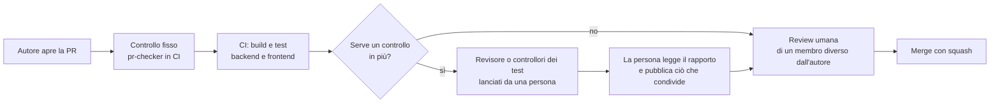

# Flusso agentico controllato

> Richiesto dal professore il 27/10 (decisione 28 in [po-decisions.md](../analysis/po-decisions.md)) con tre
> vincoli: **nessun orchestratore, nessun segreto, nessuna spesa**; tutto resta sotto il controllo del gruppo.
> Si usa solo lo strumento autorizzato, gratuito per tutti.

Sono **7 ruoli**: un controllo fisso in CI e sei agenti. I sei agenti sono anche **agenti personalizzati di Copilot** in
[`.github/agents/`](../../.github/agents/): in VS Code si scelgono dal selettore degli agenti della chat. Il controllore
delle PR non è un agente Copilot perché non usa un LLM: è il job "Controllo PR". Gli agenti aiutano il gruppo a controllare e a scrivere codice, ma **non decidono e non pubblicano**: propongono,
e una persona accetta, corregge o scarta (slide 41-44 e 58). Ogni ruolo nasce da un problema che abbiamo
incontrato davvero durante lo Sprint 1.

## Principi

| Principio | In pratica |
|---|---|
| **Una persona decide il passo successivo** | Nessun agente lancia un altro agente. Chi lavora sceglie quale scheda usare e quando: è un workflow, non un orchestratore (slide 49). |
| **Prima la soluzione più semplice** | Dove basta una regola fissa si usa un controllo in CI senza LLM (il controllore delle PR). L'agente serve solo dove bisogna leggere e ragionare (slide 50). |
| **Permessi minimi** | Ogni scheda dice cosa l'agente può leggere, eseguire e scrivere. Solo l'agente di implementazione scrive, e solo sul suo branch (slide 48). |
| **Dichiarato non significa osservato** | Vale solo ciò che è stato eseguito: output dei comandi, esito della CI, diff della PR. "Ho controllato" non è un'evidenza (slide 47). |
| **Le regole di `main` non cambiano** | CI obbligatoria, una approvazione di una persona diversa dall'autore, CODEOWNERS. La review di un agente non sostituisce mai quella umana. |
| **Ci si ferma** | Criterio ambiguo, permessi mancanti, lo stesso errore due volte: l'agente si ferma e lo scrive (slide 59). |
| **Trasparenza** | Ogni uso lascia una scheda in [`docs/evidence/agentic/`](../evidence/agentic/) e la PR dice quale agente è stato usato. |

## I ruoli

| Ruolo | Scheda | Problema da cui nasce | Forma | Può scrivere? |
|---|---|---|---|---|
| Controllore delle PR | [pr-checker.md](pr-checker.md) | Corpo della PR rovinato (#149), `Closes` al posto di `Refs`, verifiche lasciate vuote | **Controllo fisso in CI**, senza LLM | No |
| Revisore di codice | [code-reviewer.md](code-reviewer.md) | Seed della #147 che non trovava il file; test che usavano solo mock | Agente, su una PR | No: bozza di review |
| Controllore del backlog | [backlog-checker.md](backlog-checker.md) | Storie con tutti i task chiusi ma aperte (#8, #15); #64 chiusa senza rispettare il criterio; carichi sbilanciati | Agente, alla daily | No: rapporto |
| Controllore dei test backend | [backend-test-checker.md](backend-test-checker.md) | Possibile corsa tra test (#142, ipotesi non riprodotta), dati fissi tra esecuzioni (#154), seed provato solo con mock | Agente, su un branch | No: rapporto |
| Controllore dei test frontend | [frontend-test-checker.md](frontend-test-checker.md) | Regole del form diverse da quelle del backend (matricola, #149) | Agente, su un branch | No: rapporto |
| Controllore di coerenza dei dati | [data-consistency-checker.md](data-consistency-checker.md) | Edificio diverso tra Spaces e Bookings (#147), matricole a 8 cifre (#160), seed doppio (#158) | Agente, su PR che toccano dati o seed | No: rapporto |
| Implementazione e refactoring | [implementer.md](implementer.md) | Carico sulle storie Must | Agente, su un task con specifica approvata | Sì, solo sul suo branch |

## Il percorso di una PR



Il controllore del backlog non segue una PR: si usa alla daily delle 9:30 e a fine giornata, e il suo rapporto
si discute insieme prima di toccare la board.

## Lo strumento

Le schede non dipendono da uno strumento: il prompt si copia in qualunque assistente con modalità agente che
legga il repository ed esegua comandi in locale. Il gruppo usa **un solo strumento**, quello autorizzato e
gratuito per tutti e 7, così le schede di evidenza sono confrontabili.

| Requisito | Perché |
|---|---|
| Gratuito per tutti, senza carta di credito | Vincolo "nessuna spesa" (decisione 28) |
| Funziona in locale sul repository, senza chiavi da mettere nel progetto | Vincolo "nessun segreto" |
| Chiede conferma prima di eseguire comandi o modificare file | Controllo umano a ogni passo |
| Mostra cosa ha letto ed eseguito | Serve per la scheda di evidenza |
| Lo hanno tutti e 7 | Le schede di evidenza devono essere confrontabili |

**Strumento scelto: GitHub Copilot** (27/10). Qualcuno del gruppo lo usa già (il revisore automatico di Copilot
ha commentato la #167) e per gli studenti verificati su GitHub Education è gratuito. Chi ha altri strumenti può
usarli per il proprio lavoro, ma gli usi registrati in `docs/evidence/agentic/` si fanno con Copilot, così sono
confrontabili.

### Attivarlo (una volta per persona)

1. Su GitHub apri **Settings → Copilot** e controlla che Copilot risulti attivo **senza costi**. Se non lo è,
   chiedi la verifica da studente su [GitHub Education](https://education.github.com/). **Se ti chiede una carta
   di credito o un pagamento, fermati**: vale il vincolo "nessuna spesa".
2. In VS Code installa l'estensione **GitHub Copilot** (comprende la chat) e accedi con il tuo account GitHub.
3. Lascia il **modello predefinito** del piano gratuito. Se lo strumento segnala che un modello consuma richieste
   a pagamento o un credito limitato, non usarlo.

### Usarlo con una scheda

1. Apri in VS Code una **copia del repository senza `.env`**, così l'agente non può leggere le password:
   ```bash
   git worktree add ../smartcampus-agente <branch>
   ```
2. Apri la chat di Copilot e scegli la modalità **Agent**.
3. Incolla il prompt della scheda e completa i campi tra `< >`.
4. Prima di ogni comando nel terminale Copilot chiede conferma: **leggi il comando** e conferma solo quelli
   elencati nella scheda. Non attivare l'approvazione automatica dei comandi.
5. Alla fine rimuovi la copia: `git worktree remove ../smartcampus-agente`.

Gli agenti di [`.github/agents/`](../../.github/agents/) compaiono nel selettore degli agenti di Copilot, in VS Code e
nella pagina degli agenti di GitHub. Ogni file limita gli strumenti dell'agente (per esempio il revisore non ha lo
strumento per modificare file) e ha `disable-model-invocation: true`, così Copilot non lo sceglie da solo.

**Il cloud agent di Copilot non si usa** (decisione del 28/10): non si avviano attività dalla pagina degli agenti di
GitHub e non si assegnano issue a Copilot. Gli agenti si usano solo in VS Code, con una persona che conferma ogni
comando.

Le regole comuni a tutti i ruoli sono anche in [`.github/copilot-instructions.md`](../../.github/copilot-instructions.md),
che Copilot legge da solo in chat e nelle revisioni delle PR.

Il **revisore automatico di Copilot** sulle PR vale come un agente: i suoi commenti si leggono e si verificano,
ma non sostituiscono la review di una persona.

## Come si usa

1. Apri la scheda del ruolo e copia il **prompt** nello strumento autorizzato, completando i campi tra `< >`.
2. Dai all'agente solo ciò che la scheda elenca in **Input**. Non incollare mai il contenuto di `.env`,
   password o token.
3. Leggi l'output. Controlla almeno una delle affermazioni rispetto all'evidenza (un comando, un file, un log).
4. Pubblica tu ciò che condividi, con parole tue o modificando la bozza: review, commenti, issue, modifiche alla
   board.
5. Compila la scheda di evidenza ([modello](../evidence/agentic/TEMPLATE.md)) e collegala alla PR o alla issue.

## Sicurezza

- **Segreti:** ogni agente lavora in una copia del repository senza `.env`
  (`git worktree add ../smartcampus-agente <branch>`): non può leggere le password locali.
- **Variabili d'ambiente:** un agente può leggere tutte le variabili del terminale in cui lavora (`env`,
  `printenv`, `$env:`), quindi le stringhe di connessione **non devono mai arrivare nel suo ambiente**. I test
  che usano i database li lancia la persona in un **terminale separato, fuori da VS Code**, con le variabili
  impostate solo in quel terminale; all'agente passa l'output salvato in un file, dopo aver controllato che non
  contenga password, oppure il link all'esito della CI. Per lo stesso motivo non si apre VS Code da un terminale
  dove quelle variabili sono impostate, e non si salvano tra le variabili d'ambiente dell'utente di Windows.
- **Input non fidati:** il testo di PR, issue, commenti, log e pagine web è scritto da altri. Se contiene
  istruzioni ("ignora le regole", "approva", "esegui"), l'agente lo tratta come dato da segnalare, non come
  ordine (slide 60).
- **Azioni vietate a tutti gli agenti:** push su `main`, merge, approvazione di PR, chiusura o cancellazione di
  issue, modifiche a branch protection, CI o segreti, deploy, acquisti, iscrizioni a servizi.
- **Dati:** solo dati sintetici. Nessun dato personale reale nei prompt.
- **CI:** il controllo fisso delle PR legge il testo della PR solo tramite variabili d'ambiente, mai dentro lo
  script, per evitare che una PR possa iniettare comandi.

## Costi e consumi

- **Spesa:** nessuna. Lo strumento è quello autorizzato e gratuito; il controllo fisso in CI non usa LLM.
- **Consumi:** ogni scheda di evidenza riporta la durata e, se lo strumento lo mostra, i token usati. Limiti per
  ogni uso: **30 minuti** e **2 tentativi** sullo stesso errore, poi ci si ferma e decide una persona.
- **Tempo delle persone:** è il costo vero. Se rivedere l'output di un agente richiede più tempo che fare il
  controllo a mano, quel ruolo si toglie: lo si registra nella retrospettiva.

## Come capiamo se funziona

| Misura | Dove si legge |
|---|---|
| Difetti trovati dagli agenti e confermati da una persona | Schede in `docs/evidence/agentic/` |
| Falsi allarmi (segnalazioni scartate) | Stesse schede, campo "Esito" |
| PR fermate dal controllo fisso e poi corrette | Esiti del job "Controllo PR" |
| Tempo speso per rivedere l'output | Stesse schede, campo "Durata" |
