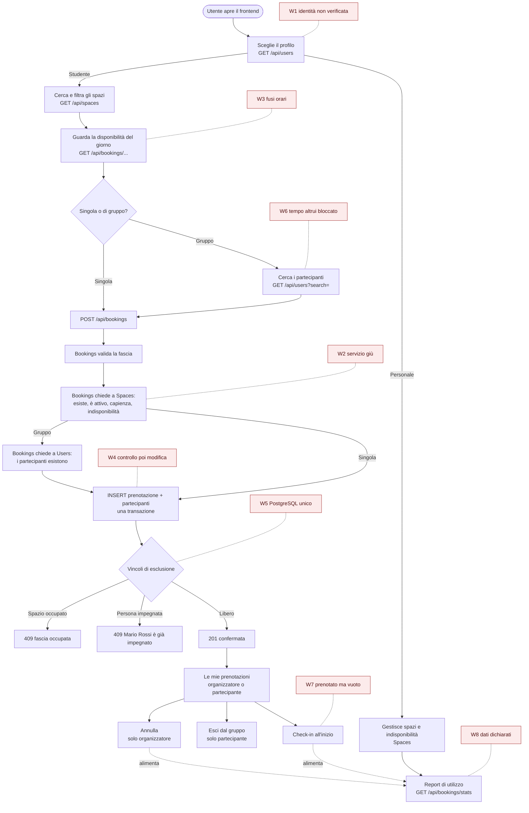

# Flusso dell'applicativo e punti deboli

> **Stato: bozza da rivedere insieme.** Il flusso segue l'architettura proposta in
> [architecture.md](../architecture.md). I punti deboli (W1–W8) sono ordinati lungo il percorso dell'utente.

## Flusso completo

## Punti deboli

| ID | Dove | Problema | Impatto | Contromisura | Stato |
|---|---|---|---|---|---|
| **W1** | Scelta del profilo | L'utente è indicato dagli header `X-User-Id` e `X-User-Role` inviati dal frontend: chiunque, con uno strumento come `curl`, può fingersi un altro utente o il personale | Alto in produzione, accettabile in una demo con dati sintetici | Limite **dichiarato**. Miglioramento se avanza tempo: token firmato (JWT) emesso da Users e verificato dai servizi | Limite noto |
| **W2** | Chiamate tra servizi | Bookings ha bisogno di Spaces (e di Users per i gruppi) per creare una prenotazione | Con un servizio giù non si prenota | Timeout di 3 s, risposta `503` chiara, il resto dell'app funziona; prove di guasto (SC-01.T6) | Nel backlog |
| **W3** | Disponibilità e prenotazione | Orari salvati e mostrati in fusi diversi; il cambio dell'ora legale sposta le fasce | Prenotazioni all'ora sbagliata, conflitti "invisibili" | API e database in **UTC** (`timestamptz`), frontend in **Europe/Rome**; test sulla notte del cambio d'ora | Da aggiungere come criterio |
| **W4** | Tra la verifica e il salvataggio | Bookings verifica lo spazio con Spaces, poi salva: se nel frattempo il personale lo disattiva o riduce la capienza, la prenotazione passa lo stesso | Raro (millisecondi), ma possibile | Limite **dichiarato**: è il prezzo di non avere transazioni tra servizi. Il caso "spazio disattivato con prenotazioni" è la domanda 4 per il PO | Limite noto |
| **W5** | Database | Un solo container PostgreSQL per tutti i servizi | Se cade, cade tutto | Accettabile per una demo locale; in produzione un database per servizio su server separati | Limite noto |
| **W6** | Prenotazione di gruppo | L'organizzatore aggiunge partecipanti senza il loro consenso, e il vincolo sulle persone **blocca la loro fascia** | Una persona può trovarsi "occupata" da un gruppo che non conosce | Il partecipante può uscire (SC-16.T3); proposta: limite di prenotazioni future per persona; alternativa: inviti da accettare (scartata per i tempi) | Da discutere con il PO |
| **W7** | Dopo la prenotazione | Una prenotazione senza check-in tiene lo spazio occupato fino alla fine | È **esattamente il problema delle slide** (7): spazio "apparentemente occupato" mentre è vuoto | Proposta: **rilascio automatico** se nessuno fa check-in entro 15 minuti dall'inizio (servizio in background in Bookings) | Proposta di nuova US |
| **W8** | Report | Il check-in è dichiarato da chi prenota: nessuno verifica che sia vero | Il report può sovrastimare l'uso | Il report lo dice esplicitamente ("uso dichiarato, non misurato"); i sensori reali sono fuori perimetro | Criterio in SC-13 |

## Che cosa ci dice il flusso

- Il punto più solido è il **salvataggio**: le due regole critiche (spazio e persona) sono garantite dal database
  in una sola transazione, anche con richieste simultanee.
- I punti più deboli rispetto al **bisogno** sono **W7** e **W6**: il primo lascia irrisolto uno dei problemi
  descritti nelle slide, il secondo ne introduce uno nuovo con le prenotazioni di gruppo.
- I punti deboli **tecnici** (W1, W4, W5) sono accettabili per una demo locale solo se **dichiarati** nei
  limiti noti e nella presentazione.
