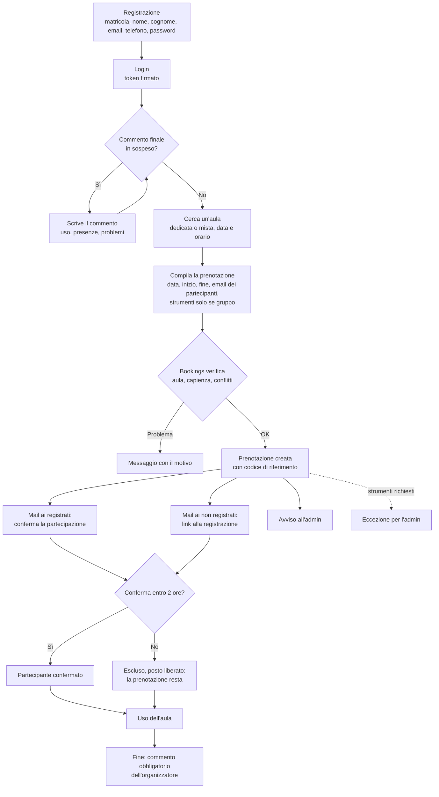
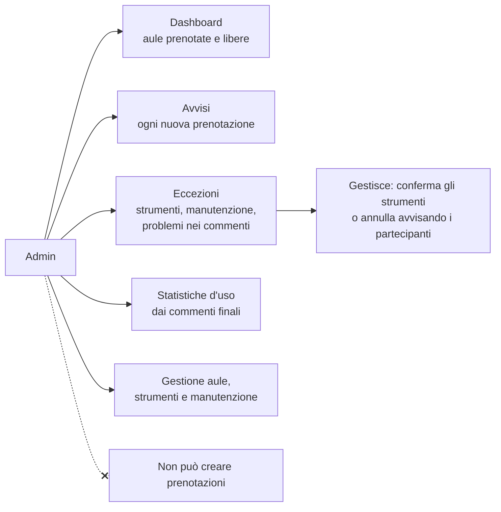
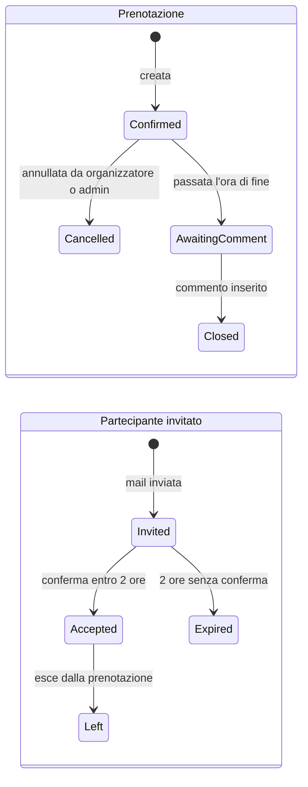

# Brainstorming del 26/10 e allineamento

> **Stato: proposta del gruppo, da validare con il PO** (incontro #85). Il brainstorming cambia parti
> importanti del prodotto: qui c'è che cosa abbiamo deciso, che cosa cambia rispetto al backlog attuale,
> il nuovo flusso, le regole e la divisione del lavoro per i tre giorni.
>
> Ruoli: **asprenolapo è lo Scrum Master** del gruppo. Il **Product Owner** resta quello comune ai gruppi
> (slide 32): il brainstorming è una **proposta** da portargli, non una decisione già valida (slide 10).

## 1. Che cosa abbiamo deciso

| # | Punto del brainstorming |
|---|---|
| 1 | L'utente si **registra** e fa il **login** tramite form: matricola, nome, cognome, email, telefono, con validazione dei campi |
| 2 | Una volta registrato, l'utente può prenotare uno spazio |
| 2.1 | Ogni prenotazione ha un **ID di riferimento** |
| 2.2 | Si prenota da **singolo** o come **gruppo** |
| 2.3 | Nel gruppo l'ID della prenotazione vale per tutti; il gruppo può includere persone **registrate e non registrate** |
| 2.4 | Gli invitati **registrati** ricevono una mail per confermare la partecipazione |
| 2.5 | Gli invitati **non registrati** ricevono una mail che li porta alla **registrazione** |
| 3 | Dall'apertura della prenotazione i partecipanti hanno **2 ore per confermare**; chi non conferma viene escluso, ma la prenotazione **non** viene cancellata |
| 4 | Aule **dedicate** a un solo gruppo o aule **miste** condivise da più gruppi piccoli o singoli |
| 5 | **Solo i gruppi** possono chiedere strumenti (videoproiettori, strumenti particolari) |
| 6 | Un **admin** supervisiona aule e prenotazioni: l'app gestisce i casi normali, l'admin le **eccezioni** (strumenti mancanti, manutenzione, cancellazioni). L'admin è avvisato di **ogni** prenotazione e di quelle con problemi |
| 7 | A fine prenotazione chi l'ha creata **deve lasciare un commento**; finché non lo fa non può crearne di nuove |
| 8 | Dati della prenotazione: responsabile (dalla registrazione, in automatico), data, ora di inizio e fine, email dei partecipanti (il loro numero dà il totale), strumenti se richiesti |
| 9 | L'admin ha una **dashboard** con aule prenotate e libere, ma **non può creare prenotazioni** |

**Decisioni tecniche prese insieme al brainstorming**

| Domanda | Decisione |
|---|---|
| Il form non ha la password: come si fa il login? | Si aggiunge la **password**; login con email o matricola + password; **token firmato (JWT)** verso i servizi |
| Come si inviano le email nella demo? | `SmtpClient` di .NET scrive ogni mail come **file `.eml` in una cartella** (`mail-outbox/`, non versionata): nessuna mail reale, nessuno strumento nuovo |
| Come copriamo "rendere comprensibile l'utilizzo" (slide 9)? | Il **commento finale** obbligatorio include se lo spazio è stato usato e quante persone erano presenti: alimenta le statistiche dell'admin. Check-in e rilascio automatico escono dal backlog |
| Aule miste: come non superare la capienza con richieste simultanee? | **Lock sull'aula nel database** (`pg_advisory_xact_lock`): una prenotazione alla volta per aula mista, si sommano i posti occupati e si inserisce solo se c'è spazio |

---

## 2. Allineamento con il backlog attuale

| Tema | Prima | Dopo il brainstorming | Effetto sul backlog |
|---|---|---|---|
| Accesso | Mock: scelta di un profilo sintetico, nessuna registrazione | **Registrazione + login con password e token** | SC-03 e SC-20 sostituite da **SC-24** (registrazione) e **SC-25** (login) |
| Ruoli | `Student`, `Staff` | **Utente** e **admin**; l'admin non prenota | Rinominare `Staff` in `Admin` |
| ID della prenotazione | UUID interno | UUID + **codice leggibile** (es. `SC-261028-4K7Q`) | Criterio in SC-06 |
| Gruppo | Partecipanti scelti tra i profili, nessuna conferma | **Email**, anche di non registrati; **conferma entro 2 ore** | SC-16 riscritta + nuova **SC-27** (conferma e mail) |
| Aule | Una prenotazione per aula alla volta | Aule **dedicate** (esclusive) e **miste** (posti fino alla capienza) | SC-04, SC-05, SC-07 adattate; nuova regola di concorrenza |
| Strumenti | Attrezzature descritte nell'aula | **Richiesta di strumenti** solo per i gruppi, gestita dall'admin | Nuova **SC-28** |
| Commento finale | Non previsto | **Obbligatorio**, blocca nuove prenotazioni | Nuova **SC-29** |
| Admin | Calendario del personale (Should) | **Dashboard** + **avvisi** + **eccezioni** | SC-18 adattata + nuova **SC-30** |
| Utilizzo | Check-in, rilascio automatico, report | Statistiche dai **commenti finali** | SC-13 adattata; SC-12 e SC-17 chiuse |
| Disattivazione aula con prenotazioni | SC-19 (flusso Spaces → Bookings) | È un'**eccezione gestita dall'admin** | SC-19 assorbita in SC-30 |
| Avviso "spazio liberato" | SC-15 (Should) | Non previsto | SC-15 chiusa |

---

## 3. Conformità con le slide

| Slide | Rischio introdotto dal brainstorming | Come lo gestiamo |
|---|---|---|
| 13 – solo dati sintetici | La registrazione raccoglie **dati personali** (email, telefono) | In demo e nei test solo dati inventati (`@smartcampus.test`); campi minimi; telefono visibile solo all'admin; password solo come hash. Da chiedere al PO se il telefono serve davvero |
| 13 – niente account né servizi esterni | L'invio di email reali richiederebbe un servizio esterno | Nessuna mail reale: file `.eml` in una cartella locale |
| 9 – rendere comprensibile l'utilizzo | Il brainstorming non lo prevede | Commento finale con uso e presenze → statistiche admin (SC-13) |
| 10 – il PO autorizza perimetro e variazioni | Il brainstorming cambia il perimetro | Si porta tutto all'incontro #85 come proposta |
| 58 – concorrenza provata sul database reale | Le aule miste aggiungono una seconda regola di concorrenza | Test di concorrenza anche per le aule miste |

---

## 4. Il nuovo flusso

### Utente

### Admin

### Stati

---

## 5. Regole proposte

### Registrazione e login

| Campo | Regola proposta |
|---|---|
| Matricola | Obbligatoria, unica, da 6 a 10 cifre (**formato da confermare con il PO**) |
| Nome, cognome | Obbligatori, da 2 a 50 caratteri; lettere (anche accentate), spazio, apostrofo, trattino |
| Email | Obbligatoria, unica, formato valido, massimo 254 caratteri, salvata in minuscolo |
| Telefono | Obbligatorio, formato italiano `+39` seguito da 9 o 10 cifre |
| Password | Almeno 10 caratteri, almeno una lettera e una cifra; salvata solo come hash (`PasswordHasher`) |

- Errori di validazione: `400` con un messaggio per ogni campo; email o matricola già registrate: `409`.
- L'**admin non si registra**: gli account admin sono pre-caricati dal seed.
- Login con **email o matricola** + password; il token (JWT) contiene id e ruolo e scade dopo 8 ore.

### Prenotazioni

| # | Regola |
|---|---|
| P1 | Ogni prenotazione ha un **codice leggibile unico** (es. `SC-261028-4K7Q`) oltre all'id interno |
| P2 | Il responsabile è l'utente del token, mai un campo inviato dal client |
| P3 | **Gruppo** = almeno un'email di partecipante. Partecipanti totali = 1 + numero di email (senza duplicati, senza l'email del responsabile) |
| P4 | **Aula dedicata**: una sola prenotazione alla volta (vincolo di esclusione). **Aula mista**: più prenotazioni insieme finché i posti occupati non superano la capienza (lock sull'aula) |
| P5 | Proposta da confermare: i **singoli** prenotano solo aule miste; i **gruppi** prenotano aule dedicate, o miste se sono al massimo 4 persone |
| P6 | Gli **strumenti** si chiedono solo nelle prenotazioni di gruppo; se l'aula non li ha, nasce un'eccezione per l'admin |
| P7 | Gli invitati hanno tempo fino a **2 ore dalla creazione** (o fino all'inizio, se arriva prima) per confermare; chi non conferma diventa `Expired`, il suo posto si libera, la prenotazione resta |
| P8 | Finché un invito è in attesa il posto resta **occupato** (conta per la capienza) |
| P9 | Un non registrato che si registra con l'email invitata trova l'invito e può confermarlo entro la stessa scadenza |
| P10 | Una persona registrata non può essere in due prenotazioni sovrapposte da **confermata** (vincolo sulle persone) |
| P11 | Dopo l'ora di fine, il responsabile **deve** inserire il commento: spazio usato sì/no, persone presenti, problemi riscontrati, commento (da 10 a 500 caratteri). Finché manca, una nuova prenotazione riceve `409` con il codice della prenotazione da commentare |
| P12 | L'admin può **annullare** una prenotazione indicando un motivo: tutti i partecipanti ricevono una mail. L'admin non può crearne |
| P13 | Ogni nuova prenotazione genera un **avviso** per l'admin; strumenti mancanti, manutenzione e problemi segnalati nei commenti generano un'**eccezione** da gestire |

### Email (tutte come file `.eml`)

| Evento | Destinatari |
|---|---|
| Prenotazione creata | Responsabile (riepilogo con codice), admin (avviso) |
| Invito a un registrato | Invitato: link per confermare |
| Invito a un non registrato | Invitato: link alla registrazione con l'invito già collegato |
| Invito scaduto | Invitato e responsabile |
| Prenotazione annullata | Tutti i partecipanti confermati e in attesa |

---

## 6. Impatto su servizi e dati

Restano **tre servizi**: nessuno strumento nuovo.

| Servizio | Che cosa aggiunge |
|---|---|
| **Users** (PostgreSQL) | Registrazione con validazione, login, emissione del token, account admin dal seed; `GET /users?emails=` per sapere quali invitati sono registrati. Libreria condivisa `SmartCampus.Auth` per verificare il token negli altri servizi |
| **Spaces** (MongoDB) | Tipo di aula `Dedicated` / `Mixed`, capienza, **strumenti disponibili** nell'aula, manutenzione |
| **Bookings** (PostgreSQL) | Codice di riferimento, inviti con scadenza a 2 ore (servizio in background), richieste di strumenti, commenti finali, avvisi ed eccezioni per l'admin, email in uscita, statistiche dai commenti |

Nuove tabelle in Bookings: `invitations`, `equipment_requests`, `closing_comments`, `admin_alerts`,
`outbox_emails`. Il modello dettagliato aggiornerà `docs/data-model.md` dopo la validazione del PO.

---

## 7. Backlog proposto

### Che cosa resta, cambia, nasce o si chiude

| Storia | Esito |
|---|---|
| SC-01 avvio, SC-02 dati sintetici, SC-14 CI | **Restano** (dati sintetici: utenti registrati e admin) |
| SC-04 catalogo, SC-05 disponibilità, SC-06 prenotazione, SC-07 nessun conflitto, SC-08 mie prenotazioni, SC-09 annullamento, SC-10 gestione aule, SC-11 manutenzione | **Restano, adattate** ad aule dedicate e miste, codice di riferimento, admin |
| SC-13 statistiche | **Adattata**: statistiche dai commenti finali |
| SC-16 prenotazione di gruppo | **Riscritta**: partecipanti per email, registrati e non |
| SC-18 calendario | **Adattata**: dashboard dell'admin con aule prenotate e libere |
| SC-21, SC-22, SC-23 processo e presentazione | **Restano** |
| SC-03 mock, SC-20 token | **Chiuse**, sostituite da SC-24 e SC-25 |
| SC-12 check-in, SC-17 rilascio automatico | **Chiuse**, sostituite dal commento finale |
| SC-15 avviso spazio liberato, SC-19 disattivazione con prenotazioni | **Chiuse** (SC-19 assorbita in SC-30) |
| **SC-24** Registrazione con validazione | **Nuova** |
| **SC-25** Login e token | **Nuova** |
| **SC-27** Conferma della partecipazione entro 2 ore, con mail | **Nuova** |
| **SC-28** Richiesta di strumenti per i gruppi | **Nuova** |
| **SC-29** Commento finale obbligatorio | **Nuova** |
| **SC-30** Avvisi ed eccezioni per l'admin | **Nuova** |

### Priorità e carico

| Priorità | Storie | Story point |
|---|---|---|
| Must | SC-01, 02, 04, 05, 06, 07, 08, 09, 10, 13, 16, 18, 21, 22, 23, 24, 25, 27, 29, 30 | **73** |
| Should | SC-11, SC-14, SC-28 | 8 |

**73 punti Must sono troppi per due giornate e mezza.** Come Scrum Master porta al PO questo ordine di taglio,
dal primo al più doloroso:

1. SC-13 statistiche → Should (i commenti finali restano salvati; si mostrano dopo) — **−3**
2. SC-30 solo avvisi, eccezioni gestite a mano → riduce a 3 punti — **−2**
3. SC-27 mail ai non registrati → Should (si invitano solo utenti già registrati) — **−2**
4. SC-22 ADR e costi in forma ridotta (una pagina) — **−1**

Anche con questi tagli restano circa **65 punti**: la priorità resta **finire e integrare** il flusso utente
completo (registrazione → prenotazione → conferma → commento) prima di tutto il resto.

---

## 8. Divisione del lavoro: nessuno si pesta i piedi

**Applicato su GitHub il 26/10:** 10 task a testa, assegnati come in questa tabella.

**Principio:** ognuno è **proprietario di cartelle**, non solo di storie. Si modifica solo il proprio codice;
se serve toccare quello di un altro, lo si chiede a lui o lo si fa con lui in review.

| Persona | Ruolo | Cartelle di cui è proprietario | Storie |
|---|---|---|---|
| **asprenolapo** | Scrum Master + piattaforma | `/` (soluzione), `docker-compose.yml`, `infra/`, `.github/`, `docs/process.md` (con Leo-prova), `docs/analysis/po-*`, `docs/decisions/` | SC-01, SC-14, SC-21 (incontro PO), SC-22 (ADR), SC-23 (prova di portabilità) |
| **fedeericodl** | Users, autenticazione, disponibilità, commento finale | `src/Services/Users/`, `src/Shared/SmartCampus.Auth/`, `tests/SmartCampus.Users.Tests/`, `data/synthetic/`, `Bookings/Features/Availability/`, `Bookings/Features/Closure/`, `src/web/src/app/closure/` | SC-02, SC-24 e SC-25 (backend), SC-05 (backend), SC-29 (verticale completo), SC-22 (valore e costi) |
| **AldAndrew0** | Spaces e strumenti, catalogo nel frontend | `src/Services/Spaces/`, `tests/SmartCampus.Spaces.Tests/`, `Bookings/Features/Equipment/`, `src/web/src/app/spaces/` | SC-04 e SC-05 (pagine), SC-10, SC-11, SC-28 (backend) |
| **Rhaastrake** | Bookings: nucleo | `src/Services/Bookings/` **tranne** le cartelle `Features/` degli altri: `Program.cs`, `Data/` (anche seed), `Migrations/`, `Domain/`, `Features/Bookings/` | SC-06, SC-07 (vincoli e aule miste), SC-09, SC-16 (schema), SC-21 (release), SC-23 (presentazione) |
| **FranDeSa456** | Bookings: gruppi, inviti, email, mie prenotazioni | `Bookings/Features/Invitations/`, `Bookings/Features/Notifications/`, `Bookings/Features/MyBookings/`, servizi in background, `src/web/src/app/invitations/` | SC-16 (backend), SC-27 (verticale completo), SC-08 (backend), test di concorrenza e di sicurezza |
| **antoStr** | Admin, verticale completo | `Bookings/Features/Admin/`, `src/web/src/app/admin/` | SC-10 (pagine), SC-13, SC-18, SC-30, SC-21 (retrospettiva) |
| **Leo-prova** | Frontend utente | `src/web/` (struttura, `core/`, `auth/`, `booking/`) **tranne** `admin/`, `spaces/`, `invitations/`, `closure/` | Pagine di SC-24, SC-25, SC-06, SC-16, SC-28, SC-08, SC-09; gestione errori; `docs/process.md` |

**I file condivisi hanno un solo proprietario**

| File | Proprietario | Regola |
|---|---|---|
| `Bookings/Program.cs` | Rhaastrake | Ogni modulo si registra con un metodo di estensione (`AddInvitations()`, `AddAdmin()`…) nel proprio file; Rhaastrake aggiunge la riga una volta sola, il primo giorno |
| `BookingsDbContext` e migrazioni | Rhaastrake | **Schema prima di tutto:** lunedì crea tutte le tabelle (anche inviti, strumenti, commenti, avvisi, email). Le modifiche successive passano da lui |
| `SmartCampus.Auth` | fedeericodl | Gli altri servizi chiamano solo `AddSmartCampusAuth()` |
| `src/web/src/app/app.routes.ts`, `core/` | Leo-prova | Ogni area ha le proprie rotte caricate a parte (`loadChildren`): `admin/`, `spaces/`, `invitations/` e `closure/` non toccano le rotte utente |
| `docker-compose.yml`, `.github/` | asprenolapo | |

**Contratti prima del codice:** entro lunedì sera `docs/api-contracts.md` elenca endpoint e DTO di ogni
servizio. Il frontend lavora subito sui contratti, con dati finti, senza aspettare il backend.

**Chi rivede chi:** chi **usa** un'API rivede la PR di chi la **scrive** (Leo rivede Users e Bookings,
FranDeSa456 rivede il nucleo di Bookings, Rhaastrake rivede Inviti, antoStr rivede Spaces…), così le
integrazioni si controllano mentre nascono.

### Piano dei tre giorni

| Giorno | Chi | Che cosa |
|---|---|---|
| **Lun 26 pomeriggio** | Tutti | Incontro con il PO (#85); scheletro della soluzione e Docker Compose (asprenolapo); schema completo di Bookings (Rhaastrake); contratti delle API (ogni proprietario per il suo servizio) |
| **Mar 27** (Sprint 1) | Tutti | Registrazione e login; aule dedicate e miste; prenotazione singola e di gruppo con codice; vincoli e test di concorrenza; pagine utente su dati finti, poi collegate. Fine giornata: review con il PO, retrospettiva, tag `v0.1` |
| **Mer 28** (Sprint 2) | Tutti | Inviti con 2 ore e mail; commento finale; strumenti; dashboard, avvisi ed eccezioni dell'admin; statistiche; test di sicurezza e prove di guasto |
| **Gio 29 mattina** | Tutti | Solo correzioni, prova della demo, presentazione |

---

## 9. Da aggiungere all'incontro con il PO

1. Il nuovo perimetro (sezione 7) e l'ordine di taglio.
2. Il telefono è davvero necessario nella registrazione? (minimizzazione dei dati)
3. Formato della matricola.
4. Chi può prenotare aule dedicate e aule miste (regola P5) e la dimensione massima di un "gruppo piccolo".
5. Prenotazione che inizia tra meno di 2 ore: la scadenza delle conferme coincide con l'inizio?
6. Elenco degli strumenti richiedibili.
7. Le mail come file `.eml` locali sono sufficienti per la demo?
