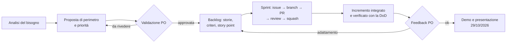

# Analisi del progetto SmartCampus

> **Stato: bozza da rivedere insieme.** Fonte: slide "Project Work SmartCampus" (ITS Bari, novembre 2026).
> Quanto segue è la nostra interpretazione: le domande aperte vanno chiarite con il PO.

## 1. Il bisogno in breve

Nel campus ci sono molte aule, laboratori e sale studio, ma **sapere che uno spazio esiste non basta**:

| Problema osservato | Conseguenza |
|---|---|
| Le informazioni sulla disponibilità sono diverse per persone diverse | Due gruppi si presentano nella stessa aula |
| Richieste e conferme passano da messaggi sparsi | Una conferma affidabile è difficile da ritrovare |
| Le cancellazioni non raggiungono chi cerca uno spazio | Aule che sembrano occupate restano vuote |
| Una prenotazione registra un'intenzione, non l'uso effettivo | Il personale non distingue uso reale, aspettative e impressioni |

**Obiettivo del prodotto:** aiutare a trovare e prenotare spazi **senza impegni incompatibili** e rendere
più comprensibile l'utilizzo, dichiarando i limiti di ciò che i dati permettono di sapere.

Il risultato atteso è un **prodotto funzionante e integrato**, non parti scollegate.

## 2. Attori

| Attore | Cosa gli serve |
|---|---|
| **Studente** | Trovare uno spazio adatto e libero, prenotarlo, avere una conferma affidabile, annullare |
| **Personale del campus** | Gestire gli spazi e le indisponibilità, capire come vengono usati senza trasformare ipotesi in certezze |
| **Product Owner** (comune ai gruppi) | Validare perimetro, priorità e criteri di accettazione |

## 3. Cosa deve fare il sistema

### Indispensabile (risultato minimo da concordare con il PO)
1. **Catalogo spazi**: tipo, capienza, attrezzature, edificio; ricerca e filtri.
2. **Disponibilità**: vedere se uno spazio è libero in una fascia oraria.
3. **Prenotazione senza conflitti**: due prenotazioni sovrapposte sullo stesso spazio non devono mai
   essere accettate, **anche se arrivano nello stesso istante**.
4. **Le mie prenotazioni**: stato chiaro (confermata, annullata), ritrovabile in ogni momento.
5. **Annullamento**: chi annulla libera subito lo spazio, e gli altri lo vedono libero.
6. **Gestione spazi** da parte del personale.
7. **Dati sintetici e avvio riproducibile**: chiunque ricostruisce il sistema con le istruzioni del README.

### Importante, se c'è tempo
8. **Indisponibilità** (manutenzione, chiusure) che bloccano le prenotazioni.
9. **Check-in**: chi usa davvero lo spazio lo dichiara. Separa l'intenzione (prenotazione) dall'uso dichiarato.
10. **Report di utilizzo** che distingue *prenotato*, *check-in avvenuto*, *nessun dato*.
    Un'assenza di dati non è un'assenza di utilizzo.

### Fuori perimetro (dalle slide)
- Sensori reali e infrastrutture di produzione.
- Dati personali reali, account a pagamento, deploy obbligatorio.
- Scenari Big Data: solo da discutere, non da implementare.

## 4. Flusso di lavoro da seguire

Ogni passaggio lascia una traccia nel repository: analisi e perimetro in `docs/analysis/`, scelte in
`docs/decisions/`, backlog nelle issue, prove in `docs/evidence/`.

## 5. Tempi

La consegna è **giovedì 29/10/2026**. Oggi è lunedì 26/10: restano **3 giornate** di lavoro.
Le slide chiedono di non contare su lavoro obbligatorio fuori aula.

| Giorno | Obiettivo |
|---|---|
| **Lun 26** | Analisi, architettura e backlog rivisti da tutti; validazione del PO; scheletro della soluzione che si avvia con un comando |
| **Mar 27** | Catalogo e prenotazione con prevenzione dei conflitti, provata sul database reale |
| **Mer 28** | Annullamento, interfaccia completa, report (se c'è tempo), dati sintetici, README, prove registrate |
| **Gio 29** | Solo correzioni e prova della demo: niente nuove funzioni |

Il dettaglio è nella [bozza del backlog](../backlog/backlog-draft.md).

## 6. Rischi

| Rischio | Impatto | Contromisura |
|---|---|---|
| Tempo molto breve con un'architettura a microservizi | Alto | Pochi servizi, scheletro comune pronto il primo giorno, perimetro minimo validato dal PO |
| Integrazione tra servizi lasciata alla fine | Alto | Il sistema si avvia integrato da subito, anche se vuoto ("walking skeleton") |
| Prevenzione dei conflitti provata solo con mock | Alto | Test di concorrenza sul database reale (le slide lo chiedono esplicitamente) |
| Un microservizio giù blocca funzioni che non dovrebbero dipendere da lui | Alto | Dipendenze e comportamento in caso di guasto definiti per ogni servizio ([architettura](../architecture.md#dipendenze-e-comportamento-in-caso-di-guasto)) e provati |
| Sette persone sugli stessi file | Medio | Un servizio per sottogruppo, PR piccole, review rapide |
| Ambienti diversi (Windows, macOS, Linux) | Medio | Database in container, istruzioni provate su almeno due sistemi |

## 7. Domande aperte per il PO

1. Quali tipi di spazio rientrano nel perimetro (aule, laboratori, sale studio)?
2. Esiste una durata massima o un anticipo massimo per una prenotazione?
3. Un gruppo prenota a nome di una persona sola o di più persone?
4. Il personale può annullare o spostare prenotazioni altrui (ad esempio per una chiusura)?
5. Il check-in è dentro il risultato minimo o è un miglioramento?
6. Che cosa deve mostrare, al minimo, il report di utilizzo?
7. In quali ambienti deve funzionare l'interfaccia (browser desktop, smartphone, app)?
