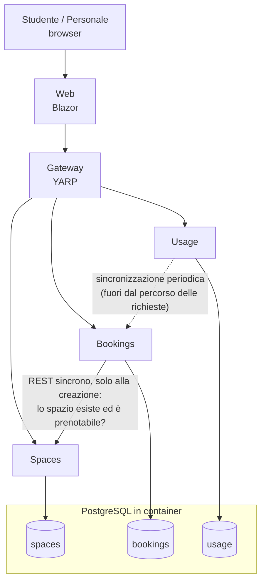
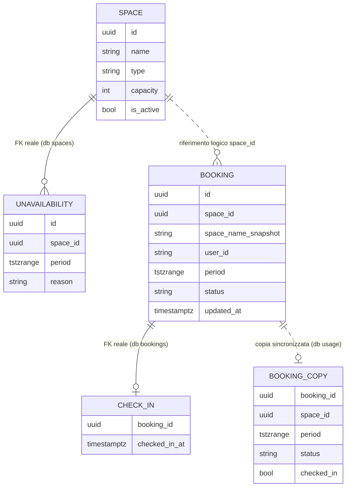
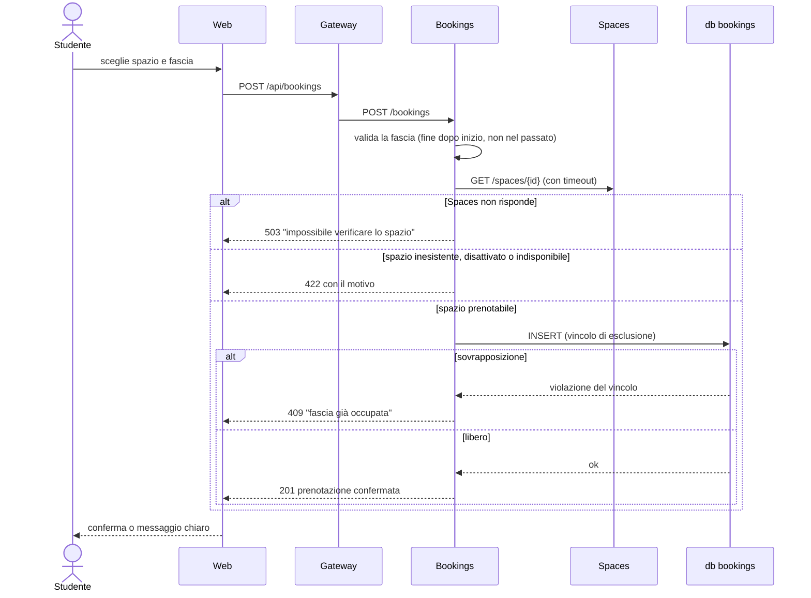
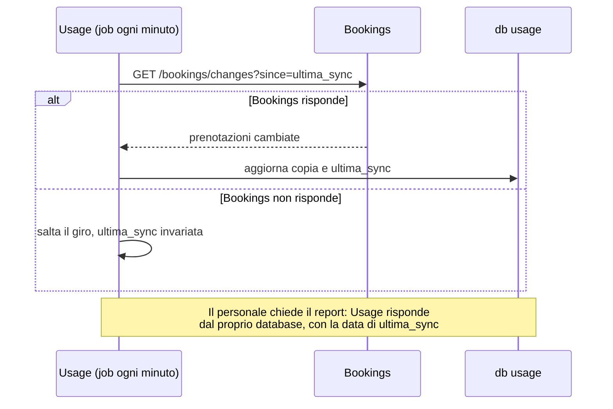

# Architettura di SmartCampus

> **Stato: proposta da rivedere insieme.** Ogni scelta riporta opzioni, pro, contro e una raccomandazione.
> Quando il gruppo concorda, la scelta diventa un ADR in [`decisions/`](decisions/).
> Le slide chiedono di **motivare** ogni scelta: "Quale scelta serve al prodotto? Quale aggiungerebbe
> soltanto complessità?".

## Vista d'insieme



Linea continua: dipendenza **sincrona**, se il servizio chiamato è giù la funzione si ferma.
Linea tratteggiata: dipendenza **asincrona**, se il servizio chiamato è giù si lavora con dati meno recenti.

Tutto si avvia insieme con **.NET Aspire** (`dotnet run` sull'AppHost), che avvia anche PostgreSQL in Docker.

## Servizi e responsabilità

| Servizio | Responsabilità | Dati di sua proprietà |
|---|---|---|
| **Spaces** | Catalogo di aule, laboratori e sale studio; attrezzature; indisponibilità (manutenzione, chiusure) | Spazi, attrezzature, indisponibilità |
| **Bookings** | Disponibilità, prenotazione, annullamento, check-in; **garantisce l'assenza di sovrapposizioni** | Prenotazioni e check-in |
| **Usage** | Report per il personale: prenotato, check-in avvenuto, nessun dato; limiti dichiarati | Copia locale delle prenotazioni e data dell'ultima sincronizzazione |
| **Gateway** | Unico punto d'ingresso per il frontend; instradamento verso i servizi | Nessuno |
| **Web** | Interfaccia per studenti e personale | Nessuno |

Regola: **ogni servizio possiede il proprio database** e nessun altro servizio lo legge direttamente.

| Rotta pubblica (Gateway) | Servizio |
|---|---|
| `/api/spaces/**` | Spaces |
| `/api/bookings/**` | Bookings |
| `/api/usage/**` | Usage |

## Relazioni tra i dati dei servizi

Con un database per servizio **non esistono foreign key tra database diversi**: PostgreSQL non può
verificare che un `space_id` salvato in `bookings` esista davvero in `spaces`. Le relazioni diventano
**riferimenti logici** (si salva solo l'identificativo) e la loro coerenza è garantita dai servizi,
non dal database.



Linea continua: foreign key vera, dentro lo stesso database. Linea tratteggiata: riferimento tra servizi
diversi, senza foreign key.

| Dato | Proprietario | Chi altro lo usa | Come |
|---|---|---|---|
| Spazio (`id`, nome, stato attivo, indisponibilità) | Spaces | Bookings | `GET /spaces/{id}` al momento della prenotazione |
| Prenotazione e check-in | Bookings | Usage | Copia sincronizzata ogni minuto (`GET /bookings/changes`) |
| Utente (`user_id`, ruolo) | Nessun servizio: elenco di utenti sintetici in `data/synthetic` (D8) | Tutti | Arriva con ogni richiesta (`X-User-Id`, `X-User-Role`) |

### Che cosa succede quando un utente prenota

1. Il Web invia a Bookings `space_id`, utente e fascia oraria.
2. **Bookings chiede a Spaces** se lo spazio esiste, è attivo e non è indisponibile in quella fascia. È
   l'unico momento in cui i due database "si parlano", e lo fanno attraverso le API, mai leggendo l'uno
   le tabelle dell'altro.
3. Bookings salva nel **proprio** database `space_id` e una **copia del nome dello spazio**
   (`space_name_snapshot`). Grazie alla copia, "Le mie prenotazioni" funziona anche con Spaces giù (vedi la
   tabella dei guasti).
4. Il vincolo di esclusione (D5) controlla le sovrapposizioni dentro il database `bookings`. Serve una
   **sola transazione locale**: nessuna transazione distribuita, nessuna saga.
5. Entro un minuto Usage copia la nuova prenotazione nel proprio database.

### Come restano coerenti i riferimenti

| Rischio | Regola |
|---|---|
| Una prenotazione punta a uno spazio cancellato | Spaces **non cancella mai** uno spazio: lo disattiva. Ogni `space_id` salvato resta valido per sempre |
| Si prenota uno spazio che non esiste | Bookings lo verifica con Spaces prima di salvare; se Spaces non risponde, rifiuta (`503`) |
| Il nome dello spazio cambia dopo la prenotazione | La copia conserva il nome al momento della prenotazione; la pagina di dettaglio mostra quello attuale chiedendolo a Spaces |
| Uno spazio viene disattivato o va in manutenzione con prenotazioni già confermate | Le prenotazioni esistenti non vengono toccate in automatico. **Domanda aperta per il PO** (n. 4 dell'analisi): se vanno annullate serve un flusso tra due servizi, da valutare dopo il risultato minimo |
| Usage mostra dati vecchi | Coerenza **eventuale**: ritardo massimo di circa un minuto, sempre dichiarato con la data dell'ultima sincronizzazione |

| Opzione per mostrare il nome dello spazio nelle prenotazioni | Pro | Contro |
|---|---|---|
| A. Il Web chiede i nomi a Spaces ogni volta (composizione delle API) | Nessuna copia, nome sempre aggiornato | Con Spaces giù l'elenco delle prenotazioni perde i nomi; più chiamate |
| **B. Copia del nome in Bookings** (raccomandata) | "Le mie prenotazioni" funziona da sola, coerente con la tabella dei guasti | Il nome copiato può essere vecchio (accettabile: è quello prenotato) |

## Struttura delle cartelle

```
src/
  SmartCampus.AppHost/            # Aspire: avvia servizi, gateway, web e PostgreSQL
  SmartCampus.ServiceDefaults/    # Health check, logging, resilienza comuni
  SmartCampus.Gateway/            # YARP reverse proxy
  SmartCampus.Web/                # Blazor Web App
  Services/
    Spaces/SmartCampus.Spaces.Api/
    Bookings/SmartCampus.Bookings.Api/
    Usage/SmartCampus.Usage.Api/
tests/
  SmartCampus.Spaces.Tests/
  SmartCampus.Bookings.Tests/      # include i test di concorrenza su PostgreSQL reale
  SmartCampus.Usage.Tests/
data/synthetic/                    # dati sintetici (JSON) e generatore
SmartCampus.slnx
```

Ogni servizio è un sottogruppo di lavoro: le PR di persone diverse toccano cartelle diverse.
Tutti i nomi (progetti, classi, rotte, tabelle) sono in inglese; vedi [CONTRIBUTING](../CONTRIBUTING.md).

---

## Dipendenze e comportamento in caso di guasto

In un'architettura a microservizi un servizio può non rispondere mentre gli altri funzionano. Per ogni
servizio va deciso **che cosa continua a funzionare, che cosa si ferma e che cosa vede l'utente**.

### Matrice delle dipendenze

| Chi | Dipende da | Tipo | Per quale funzione | Se la dipendenza è giù |
|---|---|---|---|---|
| Web | Gateway | Sincrona | Tutto | L'interfaccia non raggiunge nessun servizio |
| Gateway | Spaces, Bookings, Usage | Sincrona | Instradamento | Si ferma solo la parte del servizio giù |
| Bookings | Spaces | Sincrona | **Solo creazione** di una prenotazione: lo spazio esiste, è attivo, non è indisponibile | Le nuove prenotazioni vengono rifiutate (`503`), tutto il resto di Bookings funziona |
| Usage | Bookings | **Asincrona** (sincronizzazione periodica) | Aggiornare la copia locale delle prenotazioni | Il report resta disponibile con i dati dell'ultima sincronizzazione, con data e avviso |
| Spaces, Bookings, Usage | PostgreSQL | Sincrona | Persistenza | Il servizio risponde `503` e il suo health check diventa "unhealthy" |

Spaces non dipende da nessun altro servizio.

### Che cosa succede se va giù un servizio

| Servizio giù | Continua a funzionare | Si ferma | Cosa vede l'utente |
|---|---|---|---|
| **Spaces** | Le mie prenotazioni, annullamento, check-in, disponibilità di uno spazio, report | Catalogo e ricerca, gestione spazi e indisponibilità, **nuove prenotazioni** | "Catalogo momentaneamente non disponibile"; alla prenotazione: "Impossibile verificare lo spazio, riprova tra poco" |
| **Bookings** | Catalogo e ricerca, gestione spazi, report (dall'ultima sincronizzazione) | Disponibilità, prenotazione, annullamento, mie prenotazioni, check-in | "Prenotazioni momentaneamente non disponibili"; nel report: "Dati aggiornati alle HH:MM, le prenotazioni più recenti potrebbero mancare" |
| **Usage** | Tutto tranne il report | Report di utilizzo | "Report momentaneamente non disponibile" |
| **Gateway** | I servizi sono attivi ma irraggiungibili dall'interfaccia | Tutto | "Servizio non raggiungibile" |
| **PostgreSQL** | Nulla che usi dati | Tutti i servizi | "Servizio non raggiungibile" |
| **Web** | Le API restano attive | L'interfaccia | Pagina non raggiungibile |

**Nessun dato si perde a metà:** ogni operazione di scrittura (prenotare, annullare, check-in) è una sola
transazione nel database di un solo servizio. Se il servizio cade prima della conferma, la prenotazione
semplicemente non esiste; non può esistere "mezza prenotazione".

### Risposta alla domanda "che cosa succede a Usage se va giù Bookings?"

Nella prima versione della proposta Usage leggeva le prenotazioni da Bookings **a ogni richiesta**: con
Bookings giù il report si sarebbe fermato. Per questo la proposta cambia: Usage tiene una **copia locale**
delle prenotazioni, aggiornata periodicamente.

| Opzione | Pro | Contro |
|---|---|---|
| A. Lettura REST a ogni richiesta (proposta precedente) | Dati sempre aggiornati; nessuna copia | Con Bookings giù il report non funziona; ogni report carica Bookings |
| **B. Sincronizzazione periodica nel database di Usage** (raccomandata) | Il report funziona anche con Bookings giù; il report è indipendente dal carico di Bookings; giustifica il database di Usage | Dati in ritardo di qualche istante; un job in background da scrivere |
| C. Eventi tramite broker (RabbitMQ) | Aggiornamento quasi immediato | Un componente in più da installare e gestire; consegna duplicata o fuori ordine; troppo per 3 giorni |

Come funziona la sincronizzazione (opzione B):

1. Bookings espone `GET /bookings/changes?since=<data>`, che restituisce le prenotazioni create o
   modificate dopo quella data.
2. Usage, ogni minuto, chiama questo endpoint partendo dalla data dell'ultima sincronizzazione riuscita e
   aggiorna la propria copia.
3. Se Bookings non risponde, Usage salta il giro e riprova al successivo: la data dell'ultima
   sincronizzazione non avanza, quindi al ritorno di Bookings recupera tutto.
4. Il report mostra sempre la **data dell'ultima sincronizzazione**. Coerente con il bisogno: l'assenza di
   dati recenti non viene mai mostrata come assenza di utilizzo.

### Perché Bookings rifiuta le prenotazioni se Spaces è giù

| Opzione | Pro | Contro |
|---|---|---|
| **A. Rifiutare la prenotazione (`503`)** (raccomandata) | Nessuna prenotazione su uno spazio disattivato o in manutenzione: la conferma resta affidabile | Con Spaces giù non si prenota |
| B. Bookings tiene una copia degli spazi | Si prenota anche con Spaces giù | Si può confermare una prenotazione su uno spazio appena disattivato; un'altra sincronizzazione da scrivere |

Il bisogno principale è una **conferma affidabile**: meglio un rifiuto chiaro e temporaneo che una conferma
sbagliata.

### Flussi principali

**Creazione di una prenotazione**



**Report di utilizzo**



### Meccanismi di resilienza

- **Timeout, retry e circuit breaker** sulle chiamate HTTP tra servizi, con il gestore standard di
  resilienza di Aspire (`AddStandardResilienceHandler` in ServiceDefaults). Un servizio lento non blocca
  chi lo chiama.
- **Retry solo per le richieste che si possono ripetere senza effetti** (le `GET`). Un `POST` di
  prenotazione ripetuto automaticamente potrebbe scontrarsi con la prenotazione appena creata e restituire
  un falso `409`: per i `POST` niente retry automatico.
- **Health check** (`/health`, `/alive`) su ogni servizio, visibili nella dashboard di Aspire.
- **Degradazione nell'interfaccia:** ogni pagina gestisce da sola l'errore del proprio servizio e mostra un
  messaggio chiaro, senza bloccare le altre pagine.

### Limiti accettati

- **Gateway e PostgreSQL sono punti unici di guasto.** Per una dimostrazione locale è accettabile; in
  produzione servirebbero più istanze e database separati. Va dichiarato nei limiti noti.
- **Nessuna replica dei servizi:** ogni servizio ha una sola istanza.

### Come lo proviamo

Per ogni riga della tabella "Che cosa succede se va giù un servizio": dalla dashboard di Aspire si ferma il
servizio (Stop), si prova l'interfaccia, si riavvia il servizio e si verifica il recupero. L'esito si
registra in [`evidence/`](evidence/). In più, un test automatico verifica che Bookings risponda `503`
quando Spaces non è raggiungibile.

### Impatto sul backlog (da confermare in review)

| Modifica | Dove |
|---|---|
| Usage usa la sincronizzazione periodica invece della lettura REST a ogni richiesta | Cambia SC-13.T1 |
| Endpoint `GET /bookings/changes?since=` in Bookings | Nuovo task in SC-13 |
| Resilienza HTTP: timeout, retry solo su `GET`, circuit breaker | Nuovo task in SC-01 |
| Messaggi di servizio non disponibile in ogni pagina del Web | Nuovo task in SC-01 |
| Prove di guasto per ogni servizio, registrate in `docs/evidence/` | Nuovo task in SC-01 |

---

## Le scelte, con pro e contro

### D1 – Stile architetturale: microservizi

**Scelta del gruppo:** microservizi. Va motivata al PO, perché le slide chiedono di evitare complessità
che non serve al bisogno.

| | Microservizi | Monolite modulare (alternativa) |
|---|---|---|
| **Pro** | Confini netti: 7 persone lavorano in parallelo su servizi diversi con pochi conflitti; ogni servizio si testa e si avvia da solo; un guasto resta limitato a una parte del prodotto; obiettivo didattico esplicito | Un solo processo e un solo database: avvio, debug e test più semplici; transazioni locali; meno codice di infrastruttura |
| **Contro** | Più infrastruttura (gateway, configurazione, avvio coordinato); chiamate di rete che possono fallire e vanno gestite (vedi sopra); dati distribuiti, niente transazioni tra servizi; test di integrazione più complessi | Confini rispettati solo per disciplina; tutti lavorano nello stesso progetto, più conflitti di merge; se cade, cade tutto |

**Come contenere i contro in 3 giorni:**
- solo **3 servizi di dominio**, non uno per ogni entità;
- scheletro comune (Aspire + ServiceDefaults) pronto il **primo giorno**;
- la regola critica (niente sovrapposizioni) vive **dentro un solo servizio**, Bookings, così non
  serve nessuna transazione distribuita.

### D2 – Confini dei servizi

| Opzione | Pro | Contro |
|---|---|---|
| **A. Spaces, Bookings, Usage** (raccomandata) | Seguono i tre bisogni (trovare, prenotare, capire l'uso); conflitti gestiti in un solo posto | Usage ha bisogno dei dati di Bookings (risolto con la sincronizzazione periodica) |
| B. Aggiungere un servizio Users/Identity | Autenticazione separata e riutilizzabile | Un servizio in più da costruire, senza valore diretto per il bisogno |
| C. Bookings e check-in separati | Separa intenzione e uso | Il check-in è legato alla prenotazione: due servizi da tenere coerenti |

### D3 – Comunicazione tra servizi

| Opzione | Pro | Contro |
|---|---|---|
| **A. REST**: sincrono per Bookings → Spaces, sincronizzazione periodica per Usage ← Bookings (raccomandata) | Semplice, già noto, facile da provare e da mostrare; Usage non dipende dalla disponibilità di Bookings | Con Spaces giù non si creano prenotazioni (scelta voluta, vedi sopra) |
| B. Eventi asincroni con broker (RabbitMQ) | Servizi completamente disaccoppiati | Un componente in più; consegna duplicata o fuori ordine da gestire; difficile da completare in 3 giorni |

### D4 – Database

| Opzione | Pro | Contro |
|---|---|---|
| **A. PostgreSQL, un database per servizio nello stesso container** (raccomandata) | Gratuito e cross-platform; supporta i vincoli di esclusione sugli intervalli di tempo (vedi D5); un solo container da avviare | Un solo server condiviso è un punto unico di guasto: va dichiarato come semplificazione |
| B. SQL Server | Molto integrato con .NET | Immagine Docker pesante; su Mac con Apple Silicon più scomodo; niente vincolo di esclusione nativo |
| C. MongoDB per il catalogo + SQL per le prenotazioni | Mostra NoSQL dove la struttura è flessibile | Due tecnologie da conoscere e configurare; le slide dicono che la doppia persistenza **non** è richiesta |
| D. Un solo database condiviso | Semplicissimo | Viola il principio dei microservizi: i servizi si accoppiano tramite le tabelle |

Database: `spaces`, `bookings`, `usage`. Accesso ai dati: **Entity Framework Core** con il provider Npgsql
e le migrazioni.

### D5 – Prevenzione delle prenotazioni sovrapposte

È la regola più importante. Le slide: "per dimostrare concorrenza e persistenza servono prove sul database
reale scelto: mock e provider in-memory, da soli, non dimostrano queste proprietà".

| Opzione | Pro | Contro |
|---|---|---|
| **A. Vincolo di esclusione in PostgreSQL** (raccomandata) | È il database a rifiutare la seconda prenotazione, anche con richieste simultanee e più istanze del servizio; poche righe di SQL | Specifico di PostgreSQL (estensione `btree_gist`) |
| B. Controllo nel codice ("se è libero, inserisci") | Semplice da scrivere | **Sbagliato con richieste simultanee**: due richieste vedono lo spazio libero e inseriscono entrambe |
| C. Transazione `SERIALIZABLE` | Corretta, standard SQL | Errori di serializzazione da ritentare; più difficile da capire e provare |
| D. Lock applicativo (`lock`, semaforo) | Facile | Funziona solo con una singola istanza del servizio |

Esempio del vincolo:

```sql
CREATE EXTENSION IF NOT EXISTS btree_gist;
ALTER TABLE bookings
  ADD CONSTRAINT bookings_no_overlap
  EXCLUDE USING gist (space_id WITH =, period WITH &&)
  WHERE (status = 'Confirmed');
```

Il servizio traduce la violazione del vincolo in una risposta `409 Conflict` comprensibile per l'utente.

### D6 – Interfaccia

Le slide: "l'interfaccia è utilizzabile negli ambienti proposti e la portabilità è dimostrabile".

| Opzione | Pro | Contro |
|---|---|---|
| **A. Blazor Web App** (raccomandata) | Tutto in C#; funziona su qualsiasi sistema con un browser, anche da smartphone; portabilità facile da dimostrare | Non è un'app installabile |
| B. .NET MAUI | App nativa per Windows, Android, iOS, macOS | Build e emulatori lenti da configurare su 7 macchine; iOS richiede un Mac |
| C. React/Angular + API | Molto diffuso | Un secondo linguaggio e un secondo ecosistema da gestire |

### D7 – Avvio e orchestrazione locale

| Opzione | Pro | Contro |
|---|---|---|
| **A. .NET Aspire** (raccomandata) | Un comando avvia tutto; database, stringhe di connessione e indirizzi dei servizi configurati in automatico; dashboard con stato, log e tracce, utile anche per le prove di guasto | Strumento in più da imparare; serve Docker |
| B. Docker Compose | Standard, non dipende da .NET | Dockerfile e configurazione da scrivere per ogni servizio; debug meno immediato |

Con entrambe serve **Docker** (Docker Desktop o equivalente) su ogni macchina: va verificato subito.

### D8 – Utenti e ruoli

| Opzione | Pro | Contro |
|---|---|---|
| **A. Utenti sintetici selezionabili** (raccomandata) | Nessun account reale (come chiedono le slide); si scelgono "studente" o "personale" da un elenco; zero tempo di sviluppo sull'autenticazione | Non è sicurezza vera: va dichiarato nei limiti noti |
| B. JWT emesso da un servizio di sviluppo | Più realistico; ruoli verificati dai servizi | Un giorno di lavoro su qualcosa che non è il bisogno |
| C. Identity provider (Keycloak) | Standard | Molta configurazione, un altro container |

Ruoli nel codice: `Student`, `Staff`.

### D9 – Test

- **xUnit** per i test.
- **Testcontainers** per i test di integrazione: avviano un PostgreSQL vero in Docker, così il test di
  concorrenza (ad esempio 20 richieste simultanee sullo stesso spazio: deve passarne esattamente una) gira
  sul database reale.
- Prove di guasto come descritto sopra.
- Ogni prova eseguita si registra in [`evidence/`](evidence/) con esito atteso e osservato.

### D10 – Integrazione continua

| Opzione | Pro | Contro |
|---|---|---|
| **A. GitHub Actions: build e test su ogni PR** (raccomandata) | Gratis sui repo pubblici; il revisore vede subito se la PR rompe qualcosa; può diventare un controllo obbligatorio per il merge | Mezz'ora di configurazione |
| B. Solo test in locale | Nessuna configurazione | "Sul mio PC funziona": nessuna prova condivisa |

## Riepilogo delle raccomandazioni

| # | Scelta proposta |
|---|---|
| D1 | Microservizi (scelta del gruppo), solo 3 servizi di dominio |
| D2 | Spaces, Bookings, Usage + Gateway + Web |
| D3 | REST: sincrono per Bookings → Spaces, sincronizzazione periodica per Usage |
| D4 | PostgreSQL, un database per servizio |
| D5 | Vincolo di esclusione nel database |
| D6 | Blazor Web App |
| D7 | .NET Aspire |
| D8 | Utenti sintetici selezionabili |
| D9 | xUnit + Testcontainers + prove di guasto |
| D10 | GitHub Actions su ogni PR |

## Proposta di divisione del lavoro (7 persone)

| Area | Persone | Note |
|---|---|---|
| Platform: AppHost, Gateway, CI, dati sintetici, resilienza | 1 | Primo giorno: scheletro che si avvia per tutti |
| Spaces | 1 | |
| Bookings | 2 | Area più critica: conflitti e test di concorrenza |
| Usage | 1 | Può aiutare Bookings il primo giorno |
| Web | 2 | Parte subito con dati finti, poi si collega al Gateway |

La review incrociata tra aree diverse aiuta tutti a saper spiegare l'intero prodotto alla presentazione.
