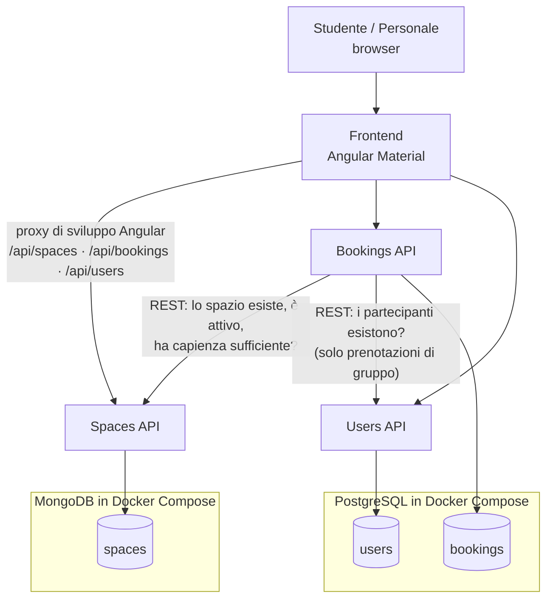
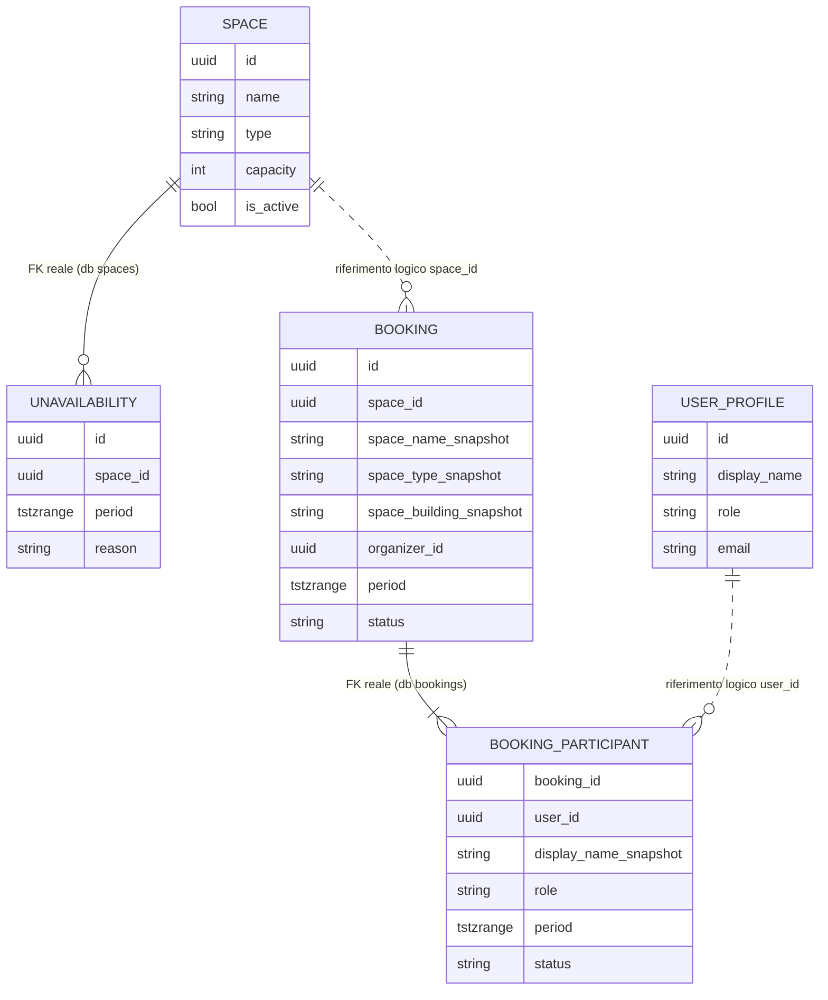
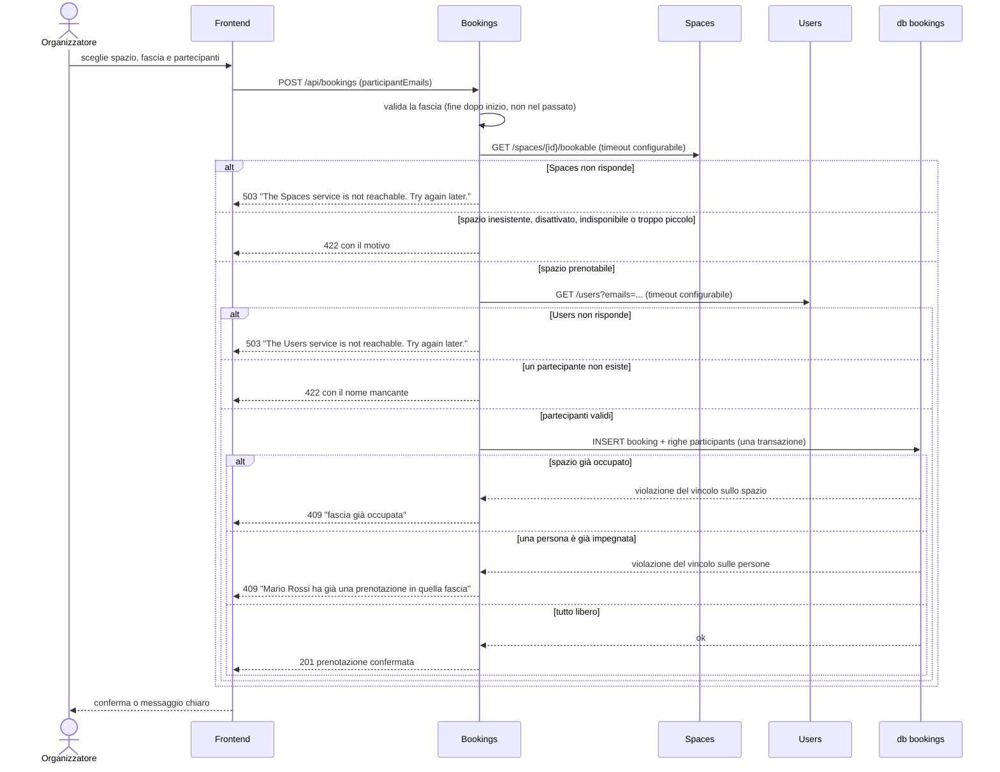

# Architettura di SmartCampus

> **Stato: scelte decise.** Le decisioni sono registrate come ADR in [`decisions/`](decisions/README.md); questo
> documento resta il confronto di opzioni, pro e contro. Dove la realizzazione è cambiata rispetto alla proposta
> (accesso con login, inviti per email, MongoDB 7.0) lo dice l'ADR e una nota nella sezione.
> Le slide chiedono di **motivare** ogni scelta: "Quale scelta serve al prodotto? Quale aggiungerebbe
> soltanto complessità?". Per questo usiamo **solo strumenti già visti durante il corso**.

## Vista d'insieme



| Componente | Tecnologia | Avvio in locale |
|---|---|---|
| Frontend | Angular + Angular Material | `ng serve` (porta 4200) |
| Spaces API | ASP.NET Core Web API, `MongoDB.Driver` | `dotnet run` (porta 5101) |
| Bookings API | ASP.NET Core Web API, EF Core | `dotnet run` (porta 5102) |
| Users API | ASP.NET Core Web API, EF Core | `dotnet run` (porta 5103) |
| Database | **MongoDB** per Spaces; **PostgreSQL** per Bookings e Users (due database nello stesso container). Dettagli in [data-model.md](data-model.md) | `docker compose up -d` |

## Servizi e responsabilità

| Servizio | Responsabilità | Dati di sua proprietà |
|---|---|---|
| **Spaces** | Catalogo di aule, laboratori e sale studio; capienza e attrezzature; indisponibilità (manutenzione, chiusure) | Spazi, attrezzature, indisponibilità |
| **Bookings** | Disponibilità; prenotazioni singole e di gruppo; inviti con conferma entro due ore; annullamento; commento finale; area admin e **statistiche di utilizzo**. **Garantisce che né uno spazio né una persona abbiano due prenotazioni sovrapposte** | Prenotazioni, inviti, commenti finali, avvisi, email in uscita |
| **Users** | Registrazione, login con email o matricola e token JWT, profili con ruolo `User` o `Admin` (ADR [0008](decisions/0008-utenti-e-accesso.md)) | Profili (matricola, nome, email, telefono, ruolo, hash della password) |
| **Frontend** | Interfaccia per studenti e personale | Nessuno |

Regola: **ogni servizio possiede il proprio database** e nessun altro servizio lo legge direttamente.

Le statistiche stanno in Bookings perché si calcolano solo dai dati delle prenotazioni: un servizio a parte
avrebbe dovuto tenerne una copia sincronizzata, con più codice e più punti di guasto.

| Rotta usata dal frontend | Inoltrata a | Esempi |
|---|---|---|
| `/api/spaces/**` | Spaces `http://localhost:5101` | `GET /spaces`, `GET /spaces/{id}`, `POST /spaces/{id}/unavailabilities` |
| `/api/bookings/**` | Bookings `http://localhost:5102` | `POST /bookings`, `GET /bookings/mine`, `POST /bookings/{id}/cancel`, `GET /bookings/availability/{spaceId}`, `POST /invitations/{id}/accept`, `GET /admin/dashboard`, `GET /admin/stats` |
| `/api/users/**` | Users `http://localhost:5103` | `POST /auth/register`, `POST /auth/login`, `GET /users?emails=`, `GET /users/{id}` |

L'inoltro lo fa il **proxy di sviluppo di Angular** (`proxy.conf.json`): il browser parla solo con
`localhost:4200`, quindi non servono gateway né configurazioni CORS.

## Struttura delle cartelle

```
docker-compose.yml                 # MongoDB (spaces) e PostgreSQL (bookings, users)
.env.example                       # variabili d'esempio, senza valori reali
infra/postgres/init.sh             # crea i database bookings, users e quelli di test
infra/mongo/init.js                # crea l'utente applicativo di spaces
src/
  Services/
    Spaces/SmartCampus.Spaces.Api/
    Bookings/SmartCampus.Bookings.Api/
    Users/SmartCampus.Users.Api/
  web/                             # progetto Angular (Angular Material)
    proxy.conf.json
tests/
  SmartCampus.Spaces.Tests/
  SmartCampus.Bookings.Tests/      # include i test di concorrenza su PostgreSQL reale
  SmartCampus.Users.Tests/
data/synthetic/                    # dati sintetici (JSON) caricati all'avvio
SmartCampus.slnx
```

Ogni servizio è un sottogruppo di lavoro: le PR di persone diverse toccano cartelle diverse.
Tutti i nomi (progetti, classi, rotte, tabelle) sono in inglese; vedi [CONTRIBUTING](../CONTRIBUTING.md).

---

## Prenotazioni singole e di gruppo

Una prenotazione ha sempre un **organizzatore** (chi prenota) e zero o più **partecipanti**, scelti tra i
profili del servizio Users.

| Regola | Come è garantita |
|---|---|
| Lo spazio non ha due prenotazioni confermate sovrapposte | Vincolo di esclusione su `bookings` (D5) |
| **Una persona non è in due prenotazioni confermate sovrapposte**, né come organizzatore né come partecipante | Vincolo di esclusione su `booking_participants` (D5) |
| Organizzatore + partecipanti non superano la capienza dello spazio | Bookings legge la capienza da Spaces prima di salvare |
| I partecipanti si invitano per email | Bookings chiede a Users quali email sono registrate (`GET /users?emails=`); chi non è registrato riceve comunque l'invito |
| Ogni invitato conferma entro due ore, o entro l'inizio se arriva prima (decisione 21) | `POST /invitations/{id}/accept`; un servizio in background porta a scaduto chi non conferma e libera il posto |
| Un partecipante può uscire dalla prenotazione | Stato `Left` previsto nel modello dei dati; nessuna API ancora su `main` |
| Solo l'organizzatore annulla l'intera prenotazione | Bookings confronta l'utente con `organizer_id` |

## Relazioni tra i dati dei servizi

Con un database per servizio **non esistono foreign key tra database diversi**: PostgreSQL non può
verificare che un `space_id` salvato in `bookings` esista davvero in `spaces`. Le relazioni diventano
**riferimenti logici** (si salva solo l'identificativo) e la loro coerenza è garantita dai servizi,
non dal database.

> Diagramma della proposta. Nello schema realizzato i partecipanti sono righe della tabella `invitations`
> (invitati per email, con stato e scadenza) e non c'è il check-in: lo schema vero è nelle migrazioni di Bookings
> (`src/Services/Bookings/SmartCampus.Bookings.Api/Migrations`).



Linea continua: foreign key vera, dentro lo stesso database. Linea tratteggiata: riferimento tra servizi
diversi, senza foreign key.

L'organizzatore è anche una riga di `booking_participants` (con `role = Organizer`): così **un solo vincolo**
impedisce a una persona di essere in due posti alla stessa ora, qualunque sia il suo ruolo. `period` e
`status` sono copiati dalla prenotazione e aggiornati nella stessa transazione.

| Dato | Proprietario | Chi altro lo usa | Come |
|---|---|---|---|
| Spazio (`id`, nome, capienza, stato, indisponibilità) | Spaces | Bookings | `GET /spaces/{id}` alla creazione della prenotazione |
| Profilo (`id`, email, ruolo) | Users | Bookings, Frontend | Bookings verifica quali email dei partecipanti sono registrate; ogni servizio legge `id` e ruolo dal token |
| Prenotazione, inviti, commento finale, statistiche | Bookings | Frontend | API di Bookings |

### Che cosa succede quando un utente prenota per un gruppo



Per una prenotazione **singola** il passo verso Users non serve: l'organizzatore è l'utente corrente.

Le scritture toccano **solo il database `bookings`, in una sola transazione**: nessuna transazione
distribuita, nessuna saga, nessuna "mezza prenotazione".

### Come restano coerenti i riferimenti

| Rischio | Regola |
|---|---|
| Una prenotazione punta a uno spazio o a un profilo cancellato | Spaces e Users **non cancellano mai**: disattivano. Ogni id salvato resta valido |
| Si prenota uno spazio o si aggiunge una persona che non esiste | Bookings lo verifica prima di salvare; se il servizio non risponde, rifiuta (`503`) |
| Nome dello spazio o della persona cambiato dopo la prenotazione | Bookings conserva una copia del nome (`*_snapshot`), così l'elenco funziona anche con Spaces o Users giù |
| Spazio disattivato o in manutenzione con prenotazioni già confermate | Le prenotazioni esistenti non vengono toccate in automatico. **Domanda aperta per il PO**: se vanno annullate serve un flusso tra due servizi, da valutare dopo il risultato minimo |

---

## Dipendenze e comportamento in caso di guasto

### Matrice delle dipendenze

| Chi | Dipende da | Per quale funzione | Se la dipendenza è giù |
|---|---|---|---|
| Frontend | Spaces, Bookings, Users | Le rispettive pagine | Si ferma solo la parte del servizio giù |
| Bookings | Spaces | Creazione di una prenotazione, disponibilità di un'aula, richieste di strumenti | Queste tre funzioni rispondono `503`, il resto funziona |
| Bookings | Users | **Solo creazione** di una prenotazione di gruppo (verifica delle email dei partecipanti) | Le prenotazioni di gruppo vengono rifiutate (`503`), quelle singole funzionano |
| Tutti i servizi | Users (indiretto) | Il token JWT si emette al login | Chi ha già un token valido (8 ore) continua: ogni servizio lo valida da solo con `SmartCampus.Auth` |
| Spaces | MongoDB | Persistenza | Spaces risponde `503`: è come se Spaces fosse giù |
| Bookings, Users | PostgreSQL | Persistenza | Il servizio risponde `503` e il suo health check fallisce |

Spaces e Users non dipendono da nessun altro servizio.

### Che cosa succede se va giù un servizio

| Servizio giù | Continua a funzionare | Si ferma | Cosa vede l'utente |
|---|---|---|---|
| **Spaces** | Login, le mie prenotazioni, annullamento, conferma degli inviti, commento finale, area admin delle prenotazioni e statistiche | Catalogo e ricerca, gestione spazi, disponibilità di un'aula, richieste di strumenti, **nuove prenotazioni** | "Catalogo momentaneamente non disponibile"; alla prenotazione: "Impossibile verificare lo spazio, riprova tra poco" |
| **Users** | Chi ha già fatto il login continua a lavorare finché il token è valido; catalogo; prenotazioni singole; le mie prenotazioni | Registrazione, login, **nuove prenotazioni di gruppo** | "Accesso momentaneamente non disponibile"; nella prenotazione di gruppo: "Impossibile verificare i partecipanti" |
| **Bookings** | Catalogo e gestione spazi, registrazione e login | Disponibilità, prenotazioni, inviti, commento finale, area admin delle prenotazioni, statistiche | "Prenotazioni momentaneamente non disponibili" |
| **MongoDB** | Come "Spaces giù" | Catalogo, gestione spazi, nuove prenotazioni | Come "Spaces giù" |
| **PostgreSQL** | Catalogo e ricerca spazi (MongoDB) | Prenotazioni, registrazione e login, statistiche | "Servizio non raggiungibile" |
| **Frontend** | Le API restano attive | L'interfaccia | Pagina non raggiungibile |

I messaggi in italiano della tabella sono quelli che deve mostrare l'interfaccia; le API rispondono `503` con il
campo `detail` in inglese (per esempio "The Spaces service is not reachable. Try again later.").

### Meccanismi di resilienza (solo strumenti di base)

- **Timeout** di 3 secondi su ogni `HttpClient` tra servizi (`HttpClient.Timeout`): un servizio lento non
  blocca chi lo chiama. In caso di timeout o errore si risponde `503` con un messaggio chiaro.
- **Nessun retry automatico sui `POST`:** una prenotazione ripetuta in automatico si scontrerebbe con quella
  appena creata e restituirebbe un falso `409`.
- **Health check** di ASP.NET Core (`AddHealthChecks`, endpoint `/health`) su ogni servizio, con controllo
  del database.
- **Degradazione nell'interfaccia:** ogni pagina Angular gestisce l'errore del proprio servizio e mostra un
  messaggio (ad esempio con uno snackbar di Angular Material), senza bloccare le altre pagine.

### Limiti accettati

- **PostgreSQL è un punto unico di guasto per Bookings e Users** (un solo container). Mitigato con riavvio automatico e health check in Compose e `EnableRetryOnFailure` in EF Core (vedi [data-model.md](data-model.md#sicurezza-dei-database)); accettabile per una dimostrazione locale.
- **Il proxy di Angular è solo per lo sviluppo.** In produzione servirebbe un reverse proxy vero.
- **Il token resta valido fino a scadenza:** con Users giù chi ha già fatto il login continua per al massimo 8 ore;
  un account disattivato nel frattempo non viene bloccato prima della scadenza del token (ADR
  [0008](decisions/0008-utenti-e-accesso.md)).

### Come lo proviamo

Per ogni riga della tabella "Che cosa succede se va giù un servizio": si ferma il servizio (Ctrl+C sul suo
`dotnet run`, oppure `docker compose stop` per il database), si prova l'interfaccia, si riavvia e si verifica
il recupero. L'esito si registra in [`evidence/2026-10-28-failure-tests.md`](evidence/2026-10-28-failure-tests.md).
In più, un test automatico verifica che Bookings risponda `503` quando Spaces non è raggiungibile.

---

## Le scelte, con pro e contro

### D1 – Stile architetturale: microservizi

**Scelta del gruppo:** microservizi, realizzati con gli strumenti del corso.

| | Microservizi | Monolite modulare (alternativa) |
|---|---|---|
| **Pro** | Confini netti: 7 persone lavorano in parallelo su servizi diversi con pochi conflitti; ogni servizio si avvia e si testa da solo; un guasto resta limitato a una parte del prodotto | Un solo processo e un solo database: avvio, debug e test più semplici; transazioni locali ovunque |
| **Contro** | Più processi da avviare; chiamate di rete che possono fallire e vanno gestite; niente foreign key né transazioni tra servizi | Confini rispettati solo per disciplina; più conflitti di merge; se cade, cade tutto |

**Come contenere i contro:** 3 servizi soltanto, sola comunicazione REST, la regola critica dentro un solo
servizio (Bookings), nessuno strumento nuovo da imparare.

### D2 – Confini dei servizi

| Opzione | Pro | Contro |
|---|---|---|
| **A. Spaces, Bookings, Users** (raccomandata) | Seguono i bisogni: trovare gli spazi, prenotare (anche in gruppo), sapere chi sono le persone; statistiche dove stanno i dati | Bookings è il servizio più grande |
| B. Spaces, Bookings, Usage, Users | Statistiche isolate | Usage deve copiare i dati di Bookings: sincronizzazione o broker, più guasti possibili |
| C. Spaces e Bookings, profili dentro Bookings | Un servizio in meno | I profili non c'entrano con le prenotazioni; Bookings diventa troppo grande |

### D3 – Comunicazione tra servizi

| Opzione | Pro | Contro |
|---|---|---|
| **A. REST sincrono con `HttpClient`** (raccomandata) | Già visto nel corso; facile da provare e da mostrare | Con Spaces giù non si creano prenotazioni (scelta voluta) |
| B. Broker di messaggi (RabbitMQ) | Servizi disaccoppiati | Mai usato nel corso; un componente in più da installare; duplicati e ordine dei messaggi da gestire |

### D4 – Database (relazionale, non relazionale o entrambi)

Le slide citano **SQL e NoSQL** tra le competenze del corso e dicono che la doppia persistenza **non è
imposta**: usarla è possibile, ma va motivata, come va motivata l'esclusione. Con un database per servizio
la scelta si fa **servizio per servizio**, guardando a cosa servono i dati.

| Servizio | Dati | Come vengono usati | Che cosa serve al database | Adatto |
|---|---|---|---|---|
| **Bookings** | Prenotazioni, partecipanti, check-in | Scritture concorrenti; letture per fascia oraria; aggregazioni per le statistiche | **Vincoli di esclusione** su spazio e persona; **transazioni** su prenotazione + partecipanti; `GROUP BY` | **Solo relazionale** (PostgreSQL) |
| **Spaces** | Spazi con attributi diversi per tipo (laboratorio: postazioni e software; aula: proiettore e lavagna; sala studio: prese e silenzio), indisponibilità | Molte letture e ricerche per filtri; poche scritture del personale | Schema flessibile, ricerca su attributi variabili; nessun vincolo tra spazi diversi | **Entrambi**: un documento per spazio è molto naturale |
| **Users** | Profili semplici (nome, ruolo, email fittizia) | Elenco e ricerca per nome | Nulla di particolare | Entrambi |

Bookings non può stare su un database documentale: MongoDB non ha vincoli tra documenti diversi, quindi
le sovrapposizioni andrebbero controllate nel codice, ed è proprio la soluzione sbagliata con richieste
simultanee (D5).

| Opzione | Pro | Contro |
|---|---|---|
| A. Tutto PostgreSQL | Un solo motore, un solo strumento di accesso (EF Core con migrazioni), un solo container; test e CI più semplici | NoSQL resta fuori: va motivato perché (B1 dell'[analisi dei requisiti](analysis/requirements-analysis.md)) |
| **E. Spaces su MongoDB, Bookings e Users su PostgreSQL** (scelta) | Usa NoSQL **dove serve davvero** (attributi diversi per tipo di spazio, indisponibilità dentro il documento dello spazio); la regola critica resta relazionale; un guasto di MongoDB ferma solo il catalogo | Due motori in Docker Compose; Spaces usa il driver ufficiale `MongoDB.Driver` invece di EF Core e non ha migrazioni (indici e dati iniziali creati all'avvio); test di Spaces su MongoDB reale; costi di gestione doppi (F5 dell'analisi) |
| B. SQL Server per tutto | Molto integrato con .NET | Nessun vincolo di esclusione: servirebbero transazioni `SERIALIZABLE` o lock; immagine pesante, scomoda sui Mac ARM |
| C. MySQL / MariaDB per tutto | Diffuso | Nessun tipo intervallo né vincolo di esclusione |
| D. MongoDB per tutto | Un solo motore NoSQL | Impossibile garantire l'assenza di sovrapposizioni con richieste simultanee |

**Scelta: opzione E.** NoSQL dove la struttura dei dati è davvero variabile (Spaces), relazionale dove servono
vincoli e transazioni (Bookings, Users). Bookings e Users usano **Entity Framework Core** (provider Npgsql) con
migrazioni; Spaces usa `MongoDB.Driver` con indici creati all'avvio. Ogni servizio riceve **solo** la stringa
di connessione del proprio database. Schemi, regole di dominio e sicurezza in [data-model.md](data-model.md).

**Aggregare dati di MongoDB e PostgreSQL** (dubbio sollevato in review). Nessuna query unisce i due database,
ma non è un costo di MongoDB: con **un database per servizio** non ci sarebbero JOIN tra Spaces e Bookings
nemmeno con tutto su PostgreSQL. I dati si uniscono in due modi:

- **copie scritte in Bookings al momento della prenotazione** (nome, tipo ed edificio dello spazio): così le
  mie prenotazioni, il calendario del personale e le statistiche per tipo o edificio si calcolano **dentro
  Bookings**, con normali `GROUP BY`;
- **composizione tramite API** dove serve il dato aggiornato, ad esempio "spazi adatti **e liberi** in una
  fascia": il frontend chiede a Spaces gli spazi che rispettano i filtri, poi a Bookings quali sono liberi.

Il dettaglio di ogni vista è in [data-model.md](data-model.md#aggregare-i-dati-di-servizi-diversi). MongoDB
aggiunge invece un costo di **gestione** (un secondo motore da avviare, proteggere e testare), già considerato
nei contro dell'opzione E.

### D5 – Prevenzione delle sovrapposizioni (spazi e persone)

È la regola più importante. Le slide: "per dimostrare concorrenza e persistenza servono prove sul database
reale scelto: mock e provider in-memory, da soli, non dimostrano queste proprietà".

| Opzione | Pro | Contro |
|---|---|---|
| **A. Vincoli di esclusione in PostgreSQL** (raccomandata) | È il database a rifiutare la seconda prenotazione, anche con richieste simultanee; poche righe di SQL in una migrazione | Specifico di PostgreSQL |
| B. Controllo nel codice ("se è libero, inserisci") | Semplice | **Sbagliato con richieste simultanee**: due richieste vedono libero e inseriscono entrambe |
| C. Transazione `SERIALIZABLE` | Standard SQL | Errori di serializzazione da ritentare; più difficile da provare |
| D. Lock applicativo (`lock`) | Facile | Funziona solo con una singola istanza del servizio |

```sql
CREATE EXTENSION IF NOT EXISTS btree_gist;

-- Uno spazio non ha due prenotazioni confermate sovrapposte
ALTER TABLE bookings
  ADD CONSTRAINT bookings_space_no_overlap
  EXCLUDE USING gist (space_id WITH =, period WITH &&)
  WHERE (status = 'Confirmed');

-- Una persona non è in due prenotazioni confermate sovrapposte
ALTER TABLE booking_participants
  ADD CONSTRAINT booking_participants_person_no_overlap
  EXCLUDE USING gist (user_id WITH =, period WITH &&)
  WHERE (status = 'Confirmed');
```

Il nome del vincolo violato dice a Bookings quale messaggio restituire (`409`: spazio occupato o persona
già impegnata).

### D6 – Frontend

Le slide: "l'interfaccia è utilizzabile negli ambienti proposti e la portabilità è dimostrabile".

| Opzione | Pro | Contro |
|---|---|---|
| **A. Angular + Angular Material** (raccomandata) | Conosciuto dal gruppo; componenti pronti (tabelle, form, date picker, snackbar); funziona in qualsiasi browser, anche da smartphone | Un secondo linguaggio (TypeScript) e Node.js da installare |
| B. Blazor | Tutto in C# | Mai usato nel corso |
| C. .NET MAUI | App nativa | Build ed emulatori lenti da configurare su 7 macchine |

### D7 – Avvio in locale

| Opzione | Pro | Contro |
|---|---|---|
| **A. Docker Compose solo per i database (MongoDB e PostgreSQL); servizi con `dotnet run`, frontend con `ng serve`** (raccomandata) | Strumenti noti; un solo file Docker; debug normale da Visual Studio o VS Code | Quattro processi da avviare (si può aggiungere uno script) |
| B. PostgreSQL installato su ogni PC | Niente Docker | Installazioni e versioni diverse su 7 macchine; i test di CI vanno configurati a parte |
| C. Tutto in Docker Compose | Un solo comando | Un Dockerfile per progetto; debug meno immediato |
| D. .NET Aspire | Avvio e configurazione automatici | **Mai usato nel corso** |

### D8 – Utenti e ruoli

> **Superata:** il PO ha approvato registrazione e login con token firmato (decisioni 14 e 17). La scelta
> realizzata, con ruoli `User` e `Admin`, è nell'ADR [0008](decisions/0008-utenti-e-accesso.md); la tabella sotto
> resta come storia della proposta.

| Opzione | Pro | Contro |
|---|---|---|
| **A. Mock: profili sintetici nel servizio Users, scelti all'ingresso** (scelta per il risultato minimo) | Nessun account reale (come chiedono le slide); i profili servono anche come partecipanti dei gruppi | Non è sicurezza vera: il frontend invia l'utente scelto (header `X-User-Id`, `X-User-Role`); va dichiarato nei limiti noti |
| **B. Account pre-caricati con password demo e token firmato (JWT) emesso da Users** (evoluzione, SC-20 #79, Should) | Simula le credenziali che studenti e personale hanno già dalla scuola; risolve il punto debole W1 | Mezza giornata di lavoro distribuita su tre persone |
| C. Registrazione di nuovi utenti | — | **Esclusa**: studenti e personale fanno già parte della scuola e hanno già le loro credenziali; anche il personale non si registra |

**Nessuna registrazione, in nessuna opzione.** Gli account esistono già: arrivano dal seed dei dati sintetici,
che simula l'anagrafica della scuola. Si parte dal mock (A); SC-20 (B) si fa solo se avanza tempo.

Ruoli nel codice: `Student`, `Staff`.

### D9 – Test

- **xUnit** per i test dei servizi.
- **Test di integrazione sui database reali di Docker Compose**, su database dedicati (`bookings_test`, `users_test` su PostgreSQL, `spaces_test` su MongoDB):
  il test di concorrenza (molte richieste simultanee sulla stessa fascia, ne passa esattamente una, sia per
  lo spazio sia per la persona) gira sul database reale.
- Prove di guasto come descritto sopra.
- Ogni prova eseguita si registra in [`evidence/`](evidence/) con esito atteso e osservato.

### D10 – Integrazione continua

| Opzione | Pro | Contro |
|---|---|---|
| **A. GitHub Actions: build e test su ogni PR** (raccomandata) | Gratis sui repo pubblici; PostgreSQL disponibile come *service container* del workflow; può diventare un controllo obbligatorio | Mezz'ora di configurazione |
| B. Solo test in locale | Nessuna configurazione | "Sul mio PC funziona": nessuna prova condivisa |

## Strumenti valutati e scartati

| Strumento | Perché no |
|---|---|
| .NET Aspire | Mai usato nel corso; Docker Compose e `dotnet run` bastano per 3 servizi |
| YARP (gateway) | Il proxy di sviluppo di Angular fa lo stesso lavoro in locale |
| RabbitMQ con outbox | Mai usato nel corso; nessuna funzione lo richiede, una volta tolto il servizio Usage |
| Blazor | Il gruppo conosce Angular |
| Testcontainers | Il PostgreSQL di Docker Compose è già un database reale per i test |

## Riepilogo delle raccomandazioni

| # | Scelta proposta |
|---|---|
| D1 | Microservizi, solo 3 servizi |
| D2 | Spaces, Bookings (con statistiche), Users |
| D3 | REST sincrono con `HttpClient` e timeout |
| D4 | Un database per servizio: Spaces su MongoDB, Bookings e Users su PostgreSQL |
| D5 | Vincoli di esclusione su spazi e persone |
| D6 | Angular + Angular Material |
| D7 | Docker Compose solo per i database (PostgreSQL e MongoDB) |
| D8 | Registrazione e login con token firmato nel servizio Users (ADR 0008) |
| D9 | xUnit + test sui database reali + prove di guasto |
| D10 | GitHub Actions su ogni PR |

## Requisiti su ogni macchina

.NET SDK 10, Node.js LTS con Angular CLI, Docker Desktop (o equivalente). Da verificare subito su tutti
e 7 i PC.
