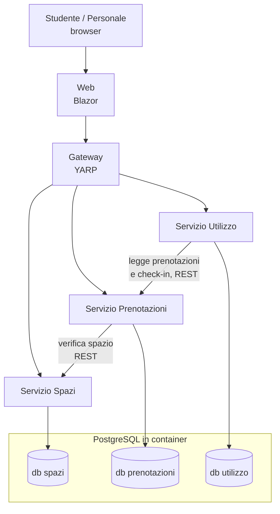

# Architettura di SmartCampus

> **Stato: proposta da rivedere insieme.** Ogni scelta riporta opzioni, pro, contro e una raccomandazione.
> Quando il gruppo concorda, la scelta diventa un ADR in [`decisioni/`](decisioni/).
> Le slide chiedono di **motivare** ogni scelta: "Quale scelta serve al prodotto? Quale aggiungerebbe
> soltanto complessità?".

## Vista d'insieme



Tutto si avvia insieme con **.NET Aspire** (`dotnet run` sull'AppHost), che avvia anche PostgreSQL in Docker.

## Servizi e responsabilità

| Servizio | Responsabilità | Dati di sua proprietà |
|---|---|---|
| **Spazi** | Catalogo di aule, laboratori e sale studio; attrezzature; indisponibilità (manutenzione, chiusure) | Spazi, attrezzature, indisponibilità |
| **Prenotazioni** | Disponibilità, prenotazione, annullamento, check-in; **garantisce l'assenza di sovrapposizioni** | Prenotazioni e check-in |
| **Utilizzo** | Report per il personale: prenotato, check-in avvenuto, nessun dato; limiti dichiarati | Aggregati e report |
| **Gateway** | Unico punto d'ingresso per il frontend; instradamento verso i servizi | Nessuno |
| **Web** | Interfaccia per studenti e personale | Nessuno |

Regola: **ogni servizio possiede il proprio database** e nessun altro servizio lo legge direttamente.

## Struttura delle cartelle

```
src/
  SmartCampus.AppHost/            # Aspire: avvia servizi, gateway, web e PostgreSQL
  SmartCampus.ServiceDefaults/    # Health check, logging, resilienza comuni
  SmartCampus.Gateway/            # YARP reverse proxy
  SmartCampus.Web/                # Blazor Web App
  Services/
    Spazi/SmartCampus.Spazi.Api/
    Prenotazioni/SmartCampus.Prenotazioni.Api/
    Utilizzo/SmartCampus.Utilizzo.Api/
tests/
  SmartCampus.Spazi.Tests/
  SmartCampus.Prenotazioni.Tests/  # include i test di concorrenza su PostgreSQL reale
  SmartCampus.Utilizzo.Tests/
data/synthetic/                    # dati sintetici (JSON) e generatore
SmartCampus.slnx
```

Ogni servizio è un sottogruppo di lavoro: le PR di persone diverse toccano cartelle diverse.

---

## Le scelte, con pro e contro

### D1 – Stile architetturale: microservizi

**Scelta del gruppo:** microservizi. Va motivata al PO, perché le slide chiedono di evitare complessità
che non serve al bisogno.

| | Microservizi | Monolite modulare (alternativa) |
|---|---|---|
| **Pro** | Confini netti: 7 persone lavorano in parallelo su servizi diversi con pochi conflitti; ogni servizio si testa e si avvia da solo; obiettivo didattico esplicito | Un solo processo e un solo database: avvio, debug e test più semplici; transazioni locali; meno codice di infrastruttura |
| **Contro** | Più infrastruttura (gateway, configurazione, avvio coordinato); chiamate di rete che possono fallire; dati distribuiti, niente transazioni tra servizi; test di integrazione più complessi | Confini rispettati solo per disciplina; tutti lavorano nello stesso progetto, più conflitti di merge |

**Come contenere i contro in 3 giorni:**
- solo **3 servizi di dominio**, non uno per ogni entità;
- scheletro comune (Aspire + ServiceDefaults) pronto il **primo giorno**;
- la regola critica (niente sovrapposizioni) vive **dentro un solo servizio**, Prenotazioni, così non
  serve nessuna transazione distribuita.

### D2 – Confini dei servizi

| Opzione | Pro | Contro |
|---|---|---|
| **A. Spazi, Prenotazioni, Utilizzo** (raccomandata) | Seguono i tre bisogni (trovare, prenotare, capire l'uso); conflitti gestiti in un solo posto | Utilizzo dipende dai dati di Prenotazioni |
| B. Aggiungere un servizio Utenti/Identità | Autenticazione separata e riutilizzabile | Un servizio in più da costruire, senza valore diretto per il bisogno |
| C. Prenotazioni e check-in separati | Separa intenzione e uso | Il check-in è legato alla prenotazione: due servizi da tenere coerenti |

### D3 – Comunicazione tra servizi

| Opzione | Pro | Contro |
|---|---|---|
| **A. REST sincrono** (raccomandata) | Semplice, già noto, facile da provare e da mostrare | Se Spazi è giù, non si può prenotare; accoppiamento temporale |
| B. Eventi asincroni con broker (RabbitMQ) | Servizi disaccoppiati; Utilizzo si aggiorna da solo | Un componente in più; consegna duplicata o fuori ordine da gestire; difficile da completare in 3 giorni |

Se resta tempo, gli eventi si possono introdurre dopo per il solo servizio Utilizzo, senza cambiare gli altri.

### D4 – Database

| Opzione | Pro | Contro |
|---|---|---|
| **A. PostgreSQL, un database per servizio nello stesso container** (raccomandata) | Gratuito e cross-platform; supporta i vincoli di esclusione sugli intervalli di tempo (vedi D5); un solo container da avviare | Un solo server condiviso: va dichiarato come semplificazione |
| B. SQL Server | Molto integrato con .NET | Immagine Docker pesante; su Mac con Apple Silicon più scomodo; niente vincolo di esclusione nativo |
| C. MongoDB per il catalogo + SQL per le prenotazioni | Mostra NoSQL dove la struttura è flessibile | Due tecnologie da conoscere e configurare; le slide dicono che la doppia persistenza **non** è richiesta |
| D. Un solo database condiviso | Semplicissimo | Viola il principio dei microservizi: i servizi si accoppiano tramite le tabelle |

Accesso ai dati: **Entity Framework Core** con il provider Npgsql e le migrazioni.

### D5 – Prevenzione delle prenotazioni sovrapposte

È la regola più importante. Le slide: "per dimostrare concorrenza e persistenza servono prove sul database
reale scelto: mock e provider in-memory, da soli, non dimostrano queste proprietà".

| Opzione | Pro | Contro |
|---|---|---|
| **A. Vincolo di esclusione in PostgreSQL** (raccomandata) | È il database a rifiutare la seconda prenotazione, anche con richieste simultanee e più istanze del servizio; poche righe di SQL | Specifico di PostgreSQL (estensione `btree_gist`) |
| B. Controllo nel codice ("se è libero, inserisci") | Semplice da scrivere | **Sbagliato con richieste simultanee**: due richieste vedono lo spazio libero e inseriscono entrambe |
| C. Transazione `SERIALIZABLE` | Corretta, standard SQL | Errori di serializzazione da ritentare; più difficile da capire e provare |
| D. Lock applicativo (`lock`, semaforo) | Facile | Funziona solo con una singola istanza del servizio |

Esempio del vincolo:

```sql
CREATE EXTENSION IF NOT EXISTS btree_gist;
ALTER TABLE prenotazioni
  ADD CONSTRAINT prenotazioni_senza_sovrapposizioni
  EXCLUDE USING gist (spazio_id WITH =, periodo WITH &&)
  WHERE (stato = 'Confermata');
```

Il servizio traduce la violazione del vincolo in una risposta `409 Conflict` comprensibile per l'utente.

### D6 – Interfaccia

Le slide: "l'interfaccia è utilizzabile negli ambienti proposti e la portabilità è dimostrabile".

| Opzione | Pro | Contro |
|---|---|---|
| **A. Blazor Web App** (raccomandata) | Tutto in C#; funziona su qualsiasi sistema con un browser, anche da smartphone; portabilità facile da dimostrare | Non è un'app installabile |
| B. .NET MAUI | App nativa per Windows, Android, iOS, macOS | Build e emulatori lenti da configurare su 7 macchine; iOS richiede un Mac |
| C. React/Angular + API | Molto diffuso | Un secondo linguaggio e un secondo ecosistema da gestire |

### D7 – Avvio e orchestrazione locale

| Opzione | Pro | Contro |
|---|---|---|
| **A. .NET Aspire** (raccomandata) | Un comando avvia tutto; database, stringhe di connessione e indirizzi dei servizi configurati in automatico; dashboard con log e tracce | Strumento in più da imparare; serve Docker |
| B. Docker Compose | Standard, non dipende da .NET | Dockerfile e configurazione da scrivere per ogni servizio; debug meno immediato |

Con entrambe serve **Docker** (Docker Desktop o equivalente) su ogni macchina: va verificato subito.

### D8 – Utenti e ruoli

| Opzione | Pro | Contro |
|---|---|---|
| **A. Utenti sintetici selezionabili** (raccomandata) | Nessun account reale (come chiedono le slide); si scelgono "studente" o "personale" da un elenco; zero tempo di sviluppo sull'autenticazione | Non è sicurezza vera: va dichiarato nei limiti noti |
| B. JWT emesso da un servizio di sviluppo | Più realistico; ruoli verificati dai servizi | Un giorno di lavoro su qualcosa che non è il bisogno |
| C. Identity provider (Keycloak) | Standard | Molta configurazione, un altro container |

### D9 – Test

- **xUnit** per i test.
- **Testcontainers** per i test di integrazione: avviano un PostgreSQL vero in Docker, così il test di
  concorrenza (ad esempio 20 richieste simultanee sullo stesso spazio: deve passarne esattamente una) gira
  sul database reale.
- Ogni prova eseguita si registra in [`prove/`](prove/) con esito atteso e osservato.

### D10 – Integrazione continua

| Opzione | Pro | Contro |
|---|---|---|
| **A. GitHub Actions: build e test su ogni PR** (raccomandata) | Gratis sui repo pubblici; il revisore vede subito se la PR rompe qualcosa; può diventare un controllo obbligatorio per il merge | Mezz'ora di configurazione |
| B. Solo test in locale | Nessuna configurazione | "Sul mio PC funziona": nessuna prova condivisa |

## Riepilogo delle raccomandazioni

| # | Scelta proposta |
|---|---|
| D1 | Microservizi (scelta del gruppo), solo 3 servizi di dominio |
| D2 | Spazi, Prenotazioni, Utilizzo + Gateway + Web |
| D3 | REST sincrono |
| D4 | PostgreSQL, un database per servizio |
| D5 | Vincolo di esclusione nel database |
| D6 | Blazor Web App |
| D7 | .NET Aspire |
| D8 | Utenti sintetici selezionabili |
| D9 | xUnit + Testcontainers |
| D10 | GitHub Actions su ogni PR |

## Proposta di divisione del lavoro (7 persone)

| Area | Persone | Note |
|---|---|---|
| Piattaforma: AppHost, Gateway, CI, dati sintetici | 1 | Primo giorno: scheletro che si avvia per tutti |
| Servizio Spazi | 1 | |
| Servizio Prenotazioni | 2 | Area più critica: conflitti e test di concorrenza |
| Servizio Utilizzo | 1 | Può aiutare Prenotazioni il primo giorno |
| Web | 2 | Parte subito con dati finti, poi si collega al Gateway |

La review incrociata tra aree diverse aiuta tutti a saper spiegare l'intero prodotto alla presentazione.
